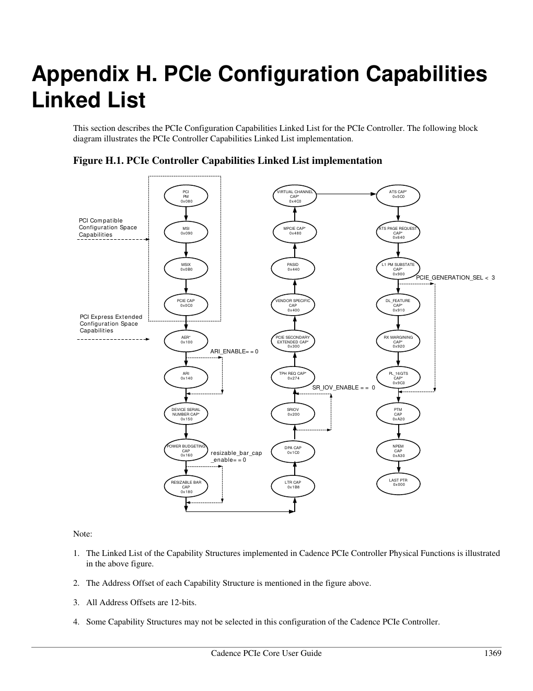

# IOMMU、ATS、PASID、PRI：同一块 Host Memory，为什么要四套名词

## 1. 从普通 DMA 地址开始

没有地址翻译时，EP 发出的 PCIe Memory Request address 可直接对应平台 memory address。加入 IOMMU 后：

```text
EP Requester ID + PCIe address(IOVA)
 → Root Complex / IOMMU Translation Agent
 → translation + permission table
 → Host physical address
 → memory/cache-coherent interconnect
```

IOMMU 不在 EP BAR 后面；它通常位于 **EP 主动访问 Host/peer memory 的 upstream 路径**。CPU 访问 EP BAR 则走 host outbound MMIO window，是另一方向。

Linux DMA API 给 driver 的 `dma_addr_t` 是 device 应放进 descriptor 的地址。IOMMU 开启时它常是 IOVA；即便暂时等于 physical address，driver 也不能依赖这个偶然。

## 2. Requester ID 是最基本的地址空间身份

IOMMU 用 Requester ID（传统 BDF，或 ARI Function ID）区分设备/Function。两个 Function 即使发同一 IOVA，也可映射到不同 physical page 或 permission。

这解释了为什么 SR-IOV 的每个 VF 需要唯一 Routing/Requester ID：它不仅用于 Completion routing，也是一道 DMA isolation identity。

## 3. ATS：让设备预先询问并缓存翻译

ATS（Address Translation Services）解决高频 DMA 每次都在 IOMMU 查表的 latency/pressure。启用后：

```text
Function 发 ATS Translation Request(untranslated address)
 → RC 的 Translation Agent 查 translation/protection table
 → ATS Translation Completion(translated address + permissions/range)
 → Function 缓存在自己的 ATC

之后 DMA MRd/MWr
 → address 来自 ATC，TLP AT field 标记 Translated
 → RC 识别已翻译请求，按平台规则快速处理
```

- **TA** 是 RC/platform 的 Translation Agent；
- **ATPT** 是其地址翻译和保护表抽象；
- **ATC** 是 Function 内的 Address Translation Cache。

ATS 不是“设备自己绕过 IOMMU”。translation 仍由可信 TA 授予，设备只能缓存通过 ATS protocol 得到的结果。

ATS 也不是用来修补“恶意设备把 DMA address 填成另一个 EP BAR”这一问题的安全结界。Untranslated Request 本来就应接受 IOMMU/TA permission；P2P Request 是否会先到 translation agent，则取决于 hierarchy routing、ACS redirect/control 和平台 topology。ATS 允许设备携带 TA 授予的 Translated address，反而要求平台更信任 Requester 正确遵守 protocol。隔离边界是 IOMMU context、Requester identity、ACS/路由与 OS ownership 的组合，不是简单地把 AT 从 `00b` 改成 `10b`。

王齐教材 §13.2 用“ATS 防止恶意 VM 把地址写成别的 EP BAR”解释安全性，适合作为风险场景的引子，但因果归属不够准确；现代实现必须按上面的 path 逐段验证。

### Invalidation 为什么复杂

OS 修改 page table 后，旧 ATC translation 不能继续用：

```text
TA → ATS Invalidation Request(range + ITAG)
Function → invalidate matching ATC entries
         → drain/nullify references and order old Posted Writes
Function → Invalidate Completion(ITAG)
TA → 收齐后才认为旧 translation 不再使用
```

这不是普通 cache flush 小事；少一次 invalidation completion 就可能让设备 DMA 到已经给别人的 page。

来源：Base Spec 5.0 §§10.1.1、10.2–10.3，printed/PDF pp.1170–1203。

## 4. PASID：在一个 Function 内再区分进程地址空间

Requester ID 只能区分 Function。若 GPU/accelerator 的同一个 Function 同时代表多个用户进程，就需要 **PASID**（Process Address Space ID）：

```text
translation context key = Requester ID + PASID
```

PASID 通过 TLP Prefix 携带，还可带 Execute Requested、Privileged Mode Requested 语义。这样 device work queue 可以提交用户 virtual address，由平台按对应进程页表/权限翻译。

PASID 并不自动保证安全：OS/IOMMU driver 必须建立 context binding，设备必须可靠地给每笔 request 加正确 PASID，reset/进程退出时还要停止并清理在途访问。

## 5. PRI：地址还没驻留时，让设备请求“把页准备好”

ATS Translation Request 若页面不存在，只能得到不可访问结果。PRI（Page Request Interface）允许 Function 发 Page Request，请平台 page-in/建立 mapping，然后收到 Page Response 再重试，适用于 Shared Virtual Memory/on-demand paging。

```text
device work uses VA + PASID
 → ATC miss / translation unavailable
 → PRI Page Request(PASID, page, permissions)
 → OS handles fault / maps page
 → Page Response
 → ATS translation / DMA resumes
```

PRI 有 outstanding request allocation/credits、Stop/Reset protocol。Function 不能无限发送 page fault 把平台打成“缺页请求生成器”。

来源：Base Spec §§10.1.2–10.1.3、10.4–10.5，printed/PDF pp.1176–1213。

## 6. 四者关系

| 能力 | 解决什么 | 最小身份 | 缓存在哪里 |
|---|---|---|---|
| IOMMU/TA | DMA translation + isolation | Requester ID | RC/IOMMU TLB |
| ATS | Function 预取/缓存 translation | Requester ID（可加 PASID） | device ATC |
| PASID | 一个 Function 下多个 process context | Requester ID + PASID | context/table key |
| PRI | page 尚不可用时请求 OS 处理 | Requester ID + optional PASID | 不是 translation cache，而是 fault protocol |

可以有 IOMMU 而无 ATS；可以 ATS 而不使用 PASID；PASID/PRI 常与 ATS/SVM 组合，但不是四个按钮必须一起全开。

## 7. Cadence core 的证据

手册确实包含：

- PF/VF ATS Capability/Control registers；
- PASID Extended Capability；
- Page Request Capability、Control/Status、Outstanding Capacity/Allocation；
- sideband `ATS_CONTROL_REG_ENABLE`、PRI Enable/Reset、PASID Enable/permission；
- AXI/TLP descriptor 中 PASID-present/value 信息；
- ATS Invalidation Request/Completion message descriptor。

这证明 RTL integration surface 支持这些协议。client logic 仍需实现 ATC、translation/page-request策略和相关 message handling；Cadence core 不等于完整 IOMMU。

但 capability 是否出现在某个 Link/Function 的最终链表，还受 configurator/static inputs/register initialization 影响。没有实际芯片 config dump，不能宣称“目标芯片所有 Function 默认已启用 ATS”。证据等级为：

- **Confirmed**：manual 定义 capability/register/sideband/message format；
- **Unknown**：实际 SoC build 的 enable、ATC 实现、IOMMU/TA topology、Linux SVA driver。

来源：Cadence Chapter 3 ATS/PASID signals；Chapter 4 ATS messages；Chapter 9 capability registers。

### 7.1 不同 Function 的能力并不对称

Appendix H 给出了这份 **controller configuration** 的精确链表。这个表很容易被一眼扫过去，但它其实在提醒我们：同一颗 PCIe core 里，PF、VF 和 RP 不是简单复制粘贴出来的三兄弟。



> 原始资料截图：Cadence *PCIe Core User Guide*, Appendix H, Figure H.1，PDF p.1458 / 文档页 1369。图里带 `*` 的能力可能没有被当前 configuration 选择；虚线路径则展示了 strap/配置关闭后链表怎样绕过该节点。正文下面的角色表是本知识库根据 Tables H.1–H.4 再整理的，别拿这张 PF 总图猜 VF。

| 工作角色 | ATS | PASID | PRI / ATS Page Request | 手册给出的 offset |
|---|---:|---:|---:|---|
| EP PF0 | 有 | 有 | 有 | ATS `0x5c0`、PASID `0x440`、ATS PR `0x640` |
| EP VF0 / VFn | 有 | 表中没有 | 表中没有 | ATS `0x5c0` |
| RP | 有 | 表中没有 | 有 | ATS `0x5c0`、ATS PR `0x640` |

因此不能因为 PF0 有 PASID capability，就顺手写成“所有 VF 都能携带独立 PASID”。反过来也不能把表中的“selected”直接等同于系统已经可用：capability 进入链表只说明 RTL build 暴露了这块配置结构；真正启用还需要合法的 capability/control 配置、RC/IOMMU 支持和相应 client logic。部分相邻 capability 还受 generation、ARI、SR-IOV 等 strap 控制，旁路后链表指针会自动跳到下一个已选择项目。

来源：Cadence Appendix H, Figure H.1 and Tables H.1–H.4, PDF pp.1458–1462（文档页 1369–1373）。

## 8. Linux 视角

普通 function driver 大多只使用 DMA API，IOMMU core 自动按 `struct device`/Requester ID 建 domain。ATS/PASID/PRI/SVA 需要 PCI core、IOMMU driver、设备 driver 共同协商，不能由 driver 只写一个 capability bit 就宣布成功。

X6000 Linux 5.10.4 的 `struct pci_dev` 包含 `ats_cap/ats_stu`、`pri_cap/pri_reqs_alloc` 和 `pasid_cap/pasid_features` 等状态；对应通用实现位于 `drivers/pci/ats.c`，IOMMU 侧位于 `drivers/iommu/`。不过，X6000 设备内核的配置和目标 DTS 并不能证明外部 Host 已为该 EP 启用 ATS/PASID/PRI；实际链路仍需 Host 内核配置、IOMMU driver 和 capability dump 共同验证。

## 9. Debug

- IOMMU fault 先记 BDF/RID、PASID、IOVA、access type；
- descriptor 用的是 DMA address，还是错塞 CPU virtual/physical；
- Function/ATS/PASID/PRI capability 是否真的 enable；
- AT field 是否与地址性质一致，translated address 必须来自 ATS；
- page-table change 后 invalidation request/completion 是否收齐；
- reset/FLR 后 ATC/context 是否失效；
- PRI allocation 是否耗尽、Response Failure/Unexpected Response 是否置位。

## 10. Source Reference

- PCI Express Base Specification 5.0 r1.0, Chapter 10, printed/PDF pp.1169–1213。
- PCI Express Base Specification 5.0 r1.0, §7.8.8 PASID, printed/PDF pp.871–874。
- 王齐《PCI Express体系结构导读》，§13.2，printed pp.352–358 / PDF pp.364–370（作为早期ATS解释及安全边界校正样本）。
- Cadence PCIe Core User Guide, ATS/PASID/PRI signal descriptions and Chapter 9 register sets。
- Cadence PCIe Core User Guide, Appendix H, Figure H.1 and Tables H.1–H.4, PDF pp.1458–1462（文档页 1369–1373）。
- X6000 Linux 5.10.4 `include/linux/pci.h`、`drivers/pci/ats.c` 与 `drivers/iommu/`。
