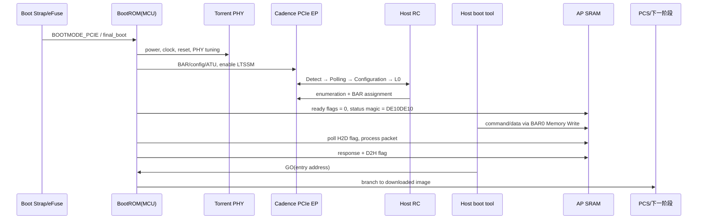

# BootROM 中的 PCIe：先搭一座独木桥，再让整座城市开机

> 研究对象：`source_repos/bootrom`。基础流程以 `origin/master`（`9357f731`）为主；X6000 扩展配置以 `origin/pcie-mkfw`（`573da310`）为主。分支之间的差异见 [bootrom_pcie_branch_matrix.md](bootrom_pcie_branch_matrix.md)。

## 1. 先说结论

X6000 BootROM 里的 PCIe 代码同时承担三件事：

1. 给 PCIe Controller、PHY、时钟和复位排出严格的上电顺序；
2. 把芯片作为 Endpoint（EP）拉到 Link Up，使 Host 能枚举它；
3. 在完整 Linux 驱动尚未运行时，借 BAR0 和 AP SRAM 实现一个极简下载协议。

所以它不是 Linux PCIe 驱动的缩小版。Linux 驱动要长期管理设备，BootROM 只需要先搭出一座可靠的“独木桥”：Host 能找到设备、能往 SRAM 塞程序、能让 MCU 跳过去执行，任务就完成了一大半。

## 2. 它在整机启动链中的位置



直觉上，Link Up 只是“公路修通”；BAR 和 inbound translation 决定“下高速后能到哪栋楼”；ready flag 协议则是双方约定的“门铃”。三者少一个，Host 工具都不能正常下载。

## 3. BootROM 何时初始化 PCIe

`edge10/main.c` 不是只在 `BOOTMODE_PCIE` 时碰 PCIe：

- 显式 PCIe 启动：调用 `pcie_ep_init()`，成功后进入 `pcie_main()`；
- eMMC、SD、SPI NAND、SPI NOR 的 `final_boot` 路径：先初始化 PCIe；本地介质失败后，以 PCIe 作为最终恢复通道；
- UART 路径在定义 `PREINIT_PCIE` 时也可以预初始化 PCIe；
- `PRELOAD_PCS` 时 Die0 可直接跳到预加载 PCS，绕过普通介质选择。

这解释了一个容易误会的现象：看到“从 eMMC 启动”，不代表 PCIe 一定没起来。`final_boot` 可以让它在后台先把 EP Link 准备好。

Source:

- `origin/master:edge10/main.c`, lines 45–175
- `origin/master:edge10/device/pcie/pcie_main.c`, `pcie_ep_init()` / `pcie_main()`

## 4. `pcie_ep_init()` 的冷启动顺序

下面按硬件依赖重排代码，而不是照着寄存器地址念经。

### 4.1 外部 PCIe 初始化固件优先

BootROM 先读取 eFuse block 243 和备份 block 244 的 `EFUSE_PCIE_EXT_INIT` 位。任一置位时：

1. 初始化 SPI master；
2. 从 NOR offset `0x0` 读取外部代码长度；
3. 从 offset `0x4` 把代码复制到 AON SRAM 的 `PCIE_ENTRY_OFFSET - 1`；
4. 跳转到 `PCIE_ENTRY_OFFSET` 执行 `pcie_ep_init_ext()` 一类入口；
5. 等待 Link Up 后返回。

这是一种很实用的 ROM 可补丁化设计：硬件量产以后，PHY 调参、BAR 组合、MPS 或芯片变体仍可由 NOR 中的 16 KiB 左右扩展固件修正。ROM 不必拥有预知未来的水晶球。

`pcie_main_ex.c` 被链接到专门的 `.pcie.text` / `.pcie.str` 区域；Makefile 再从大镜像固定位置抽取 `pcie.bin`。在最新 `pcie-mkfw` 中，不同 `BOARD` 会定义 `IPU_X2000`、`IPU_X5000`、`IPU_X6000`、`IPU_X6000_VS`、`IPU_X6000_LM` 或 `IPU_X6000_DS`。

Source:

- `origin/master:edge10/device/pcie/pcie_main.c`, external-init branch in `pcie_ep_init()`
- `origin/pcie-mkfw:edge10/Makefile`, `PCIE_EXT` and `BOARD` conditionals
- `origin/pcie-mkfw:edge10/sections.ld`, `.pcie.text.first`, `.pcie.text`, `.pcie.str`
- `origin/pcie-mkfw:edge10/mk.sh`

### 4.2 打开 HSIO 电源与时钟

普通路径依次执行：

1. 通过 PMU set alias 拉起 HSIO POR reset；
2. 等待 20 μs；
3. 打开 HSIO power-domain clock gating；
4. 再等 10 μs；
5. 依据 `boot_strap.pll_bypass` 选择 HSIO APB/AXI 时钟源；
6. 冷启动时释放 HSIO system control reset；
7. 选择 PCIe PIPE mux，并打开 PCIe APB、AXI、PM 和 combo PHY 时钟。

这些 delay 不是礼貌性停顿。`pcie_init` 与之后 master 的差异中，多个 1–20 μs 延时正是后续补入的时序修正。

### 4.3 冷启动和 Hot Reset 必须分开

`AON_PCIE_HOT_RESET_STATUS_ADDR` 决定本次是否为 PCIe Hot Reset：

- 冷启动负责完整 PHY、sticky management、clock/reset 初始化；
- Hot Reset 不应粗暴重置仍有状态依赖的整个 HSIO/PHY；代码会先关闭 Link Training，再走缩短流程；
- management sticky reset 只在冷启动释放。

这和 PCIe 协议语义一致：Hot Reset 的目标是重新初始化链路/功能状态，并不等于 SoC 掉电重启。

### 4.4 配置 Torrent PHY

ASIC 路径配置 common PLL、lock reference count、charge pump、filter、bias、RX/TX calibration，以及 8 条 lane 的 DFE/LFEQ 参数。

这里能看到清晰的硬件层次：

```text
PMU / HSIO system control
        ↓
Torrent PHY common PLL
        ↓
lane 0..7 receiver/equalizer tuning
        ↓
PIPE interface
        ↓
Cadence PCIe controller LTSSM
```

PHY 寄存器决定模拟链路能不能可靠收发；LTSSM 决定协议训练走到哪一步。把两者混称为“PCIe 初始化寄存器”会让 Debug 非常痛苦。

### 4.5 三阶段配置固件

master 支持从以下位置寻找 magic `0xDE10DE10`：

1. I2C EEPROM；
2. SPI NOR；
3. eFuse；
4. 都不存在则使用 ROM 默认值。

配置镜像不是可执行 C 代码，而是一组 8 字节 item：

```c
struct FW_CFG_ITEM {
    u32 addr_op_valid; /* address[31:2], op[1], valid[0] */
    u32 val;
};
```

- `valid=0`：本阶段结束；
- `op=1`：向编码地址写 `val`；
- `op=0`：读一次编码地址；
- 只允许访问 PCIe Controller、Torrent PHY、PCIe system control 与 HSIO system control 白名单范围；
- stage 1 首次载入整包并校验 checksum16，失败重读，最多两次；
- 三个 offset 指向三组配置项。

三个 stage 插在不同的复位边界：

```text
stage 1: PHY/core 仍处于较早复位阶段
    ↓ release combo PHY reset
stage 2: PHY clock stable，PIPE/link/AXI 尚未全释放
    ↓ release PIPE/link/AXI/mgmt/PM reset
stage 3: controller 可配置，LTSSM 尚未 enable
    ↓ enable config + link training
```

这套设计的精髓不是“有三个数组”，而是某些寄存器只有在特定复位窗口写入才生效。

### 4.6 等 PHY clock stable，然后释放数字逻辑

代码轮询 `PCIEX8_CONTROLLER_MISC_CTRL_STS2.PHY_CLK_STABLE`。寄存器语义看起来有些反直觉：代码在 mask 后结果为 0 时认为 stable，需要结合芯片寄存器手册确认该位是否为低有效或命名经过包装。

随后依次释放：

- PCIe PIPE reset；
- Link reset；
- AXI reset；
- management sticky reset（仅冷启动）；
- management reset；
- PM reset。

最后设置 controller debug mux bit 31，并在 FPGA 构建中补 BAR、class code、Completion credit 配置。

### 4.7 启动 LTSSM 并等待 L0

BootROM 设置：

- `CONFIG_ENABLE`；
- `LINK_TRAINING_ENABLE`。

然后轮询 `MISC_CTRL_STS2.LINK_STATUS == 0x3`。master 已取消 Link Up 超时，意味着它宁可一直等 Host，也不把“主机还没上电”误判成永久硬件故障。

早期版本曾直接读取 LTSSM state 并要求连续多次进入 L0/L0s 状态；后续版本改用 SoC wrapper 暴露的 link status。前者信息丰富，后者更短、更适合 ROM。

## 5. Link Up 以后，Host 到底访问到了哪里

BootROM 在 `pcie_main()` 开始时配置：

```text
BAR0 inbound ATU low = 0x6007FA00 & ~0xff = 0x6007FA00
BAR0 inbound ATU high = 0
```

随后初始化 AP SRAM 尾部邮箱：

| BAR0 offset | EP 本地地址 | 用途 |
|---:|---:|---|
| `0x7fa00` | `0x6007fa00` | Host→Device ready |
| `0x7fa40` | `0x6007fa40` | PCIe ready/status magic |
| `0x7fa80` | `0x6007fa80` | Device→Host ready |
| `0x7fb00` | `0x6007fb00` | Host→Device packet buffer |
| `0x7fd80` | `0x6007fd80` | Device→Host packet buffer |

一次 Host 写命令的真实路径是：

```text
Host userspace
  → Host boot driver BAR0 mapping
  → CPU store to BAR0 + 0x7fb00
  → Root Port 产生 PCIe Memory Write TLP
  → Endpoint BAR0 命中
  → Cadence inbound ATU
  → EP AXI address 0x6007fb00
  → AP SRAM
```

随后 Host 写 `BAR0 + 0x7fa00 = 1`。BootROM MCU 一直轮询本地地址 `0x6007fa00`，见到 1 后解析 SRAM 中的数据。这不是 DMA，也没有神秘的“PCIe 自动搬运线程”；就是 Host 的 Memory Write TLP 最终落进了 SRAM。

## 6. 下载协议

BootROM 复用了 UART/SPI/USB 的 datastream 协议：

- `CMD` 固定 17 字节；
- `DATA` 的 payload length 位于 byte 3/4，总帧长为 payload + 8；
- 常见命令包括 READ、WRITE、DOWNLOAD 与 GO；
- `process_command()` 和 `process_data()` 与传输介质解耦；
- PCIe 适配层只负责从共享 SRAM 取包和放回响应。

邮箱是单槽 stop-and-wait：发送方必须等 ready 清零再覆盖 buffer。它很慢，但实现小、状态少、非常适合 BootROM。

### GO 的交接细节

`GO(address)` 最终把 address 转为函数指针并直接跳转。`pcie_second_boot` 分支会在 GO 前清除 BAR0 inbound ATU；master 后来移除了这一步。

这处差异非常关键：

- 清 ATU：下一阶段必须自行重建 BAR 入口，但避免继承 ROM 的临时映射；
- 不清 ATU：Host 下载通道可跨阶段保持，但下一阶段重编 APT/ATU 时必须理解已有状态。

PCS 源码研究需要继续确认最终产品选择了哪一种交接契约。

## 7. `pcie-mkfw` 如何扩展为 X6000 配置固件

最新分支的 `pcie_main_ex.c` 已经从“PHY 初始化补丁”长成多产品配置器。

### 7.1 统一身份

各产品均写 Device ID/Vendor ID：

```text
0x58000000 = 0x200017cd
              device=0x2000, vendor=0x17cd
```

这与 Host `edge-driver` 支持的 `17cd:2000` 一致；早期 BootROM Host helper driver 绑定的是 `17cd:0100`，更早的 Cadence 示例甚至是 `10ee:8014`。

### 7.2 X6000 Group A/B 的 BAR 不是同一种布局

`group_id` 来自 eFuse block 81 bit 1。

| 产品形态 | Group A | Group B |
|---|---|---|
| X6000 | BAR0 16M 32-bit NP；BAR1 16M 32-bit NP；BAR2 64M 64-bit P；BAR4 1G 64-bit P | BAR0 16M 64-bit NP；BAR2 64M 64-bit P；BAR4 4G 64-bit P |
| X6000 VS | A 类似，但 BAR4 为 64M | B 只有 BAR0 16M 与 BAR2 64M |
| X6000 LM | A 使用多个 16M BAR；B 为 BAR0 16M、BAR2 16M、BAR4 4G | 同左所述分组 |
| X6000 DS | A 的 BAR2 为 32M、BAR4 为 1G；B 为 BAR0 16M、BAR2 16M、BAR4 4G | 同左所述分组 |

NP 是 non-prefetchable，表示读操作不能被随意预取；P 是 prefetchable，通常用于大块数据窗口。32-bit/64-bit 描述 BAR 消耗几个配置寄存器槽以及可承载的 PCI 地址宽度，不是说 CPU 只能用 32/64 位指令访问。

### 7.3 BootROM 临时 APT

X6000 主形态配置 7 个 APT region，把从 `0x60000000` 开始的 AXI slave aperture 分别指向：

- AP SRAM 多段；
- PCIe system control `0x5a200000`；
- controller 辅助窗口 `0x5a216000`；
- eFuse `0xa7400000`。

代码注释明确说：这只是 BootROM 阶段的临时 APT，PCS 会改写它。这个注释为 Linux 中看到的最终 APT 配置找到了上游交接点。

非普通 X6000 形态采用更小的四 region 布局：AP SRAM、PCIe system control、辅助窗口、eFuse。

### 7.4 额外策略

X6000/DS 分支还会：

- 最大 non-posted outstanding request 设为 4；
- 关闭 ordering check；
- MPS 设为 1024 bytes（编码 `3`）；
- 清 relaxed ordering enable；
- 在 AP SRAM 保存 PCIe firmware version、reset history、SN/card 信息；
- 写产品 magic 区分 LM、DS、VS 与普通 X6000；
- 初始化多 die 的 boot state / IPCM valid 标志。

注意：MPS=1024 只是 EP 能力/控制的一侧设置。链路实际使用的 MPS 还必须服从 RC 枚举后的协商和 Linux 配置，不能看到这个寄存器就宣布所有 TLP payload 都是 1024。

### 7.5 2026 分支尾部的 FLR/MSI-X 实验

`pcie-mkfw` tip 无条件定义 `IRQ_TEST`，安装一张 Cortex-M 向量表，配置 MSI-X table/PBA，并为 IRQ 36 注册处理器；handler 会写 controller/system 寄存器处理 FLR 相关状态。

这部分由提交 `daca31c`（BootROM 响应中断）和 `573da31`（虚拟化功能）演进而来。代码里仍保留大量测试日志与硬编码地址，因此本文把它归类为“分支 tip 中存在的实验/开发实现”，不能仅凭分支名推断已经进入量产启动链。

## 8. Host helper driver 与工具有一处接口断层

BootROM 仓库自带 `pcie_boot_driver`：

- `pci_enable_device()`；
- `pci_set_master()`；
- request/map BAR0；
- `/dev/edge_boot` 的 `read()` / `write()` 在四个 mailbox 地址上轮询；
- `mmap()` 允许用户态映射 BAR0。

但同仓库 `bootrom_utility_tool/pcie.c` 调用的是 ioctl 2/3，而当前 `edge_boot.c` 的 `file_operations` 没有 `.unlocked_ioctl`，只有 `.read/.write`。因此这两个 tip 文件并不是可直接配对运行的同一代 ABI。

这是静态源码能确定的事实，不应靠“它们放在同一仓库”替它们强行圆满。需要从部署脚本、旧 driver commit 或实际 rootfs 中找出匹配版本。

另外，driver 中 `pci_request_regions()` 的返回值没有赋给 `rc` 就立刻检查 `rc`，也是明确的错误路径 bug。

## 9. BootROM 与 Linux 的所有权边界

Linux EP controller driver 的 `probe()` 会初始化电源、PHY、clock 与 reset，但主 EP 路径没有调用完整的 mode/speed/lane controller init。结合 BootROM：

```text
BootROM / external PCIe firmware
    owns: PHY tuning, initial BAR identity, initial LTSSM, boot APT
             ↓
PCS
    confirmed: retain Host-facing Link, replace temporary APT, DE11 mailbox
             ↓
ATF
    confirmed: add region9/uDMA bulk, DE12, C2C enumeration与IRQ relay
             ↓
Linux EPC + EPF
    owns/updates: product DTS selected APT, outbound windows, MSI-X, notify
    preserves: firmware APT entries not overwritten by final DTS
```

PCS/ATF现已由对应仓库源码验证；逐项交接见
[X6000启动交接与所有权](x6000_boot_handoff_and_ownership.md)。

## 10. Debug 提示

### Link 根本不出现

按顺序查：

1. boot strap 是否真的进入 PCIe/final boot；
2. `EFUSE_PCIE_EXT_INIT` 是否让 ROM 跳进了另一份扩展固件；
3. HSIO PMU power/reset 与 refclk；
4. `PHY_CLK_STABLE` 的实际极性；
5. PIPE/link/AXI/mgmt reset 是否全部释放；
6. `CONFIG_ENABLE` 与 `LINK_TRAINING_ENABLE`；
7. LTSSM/link status。

### 能枚举，但 magic 永远读不到

Link 层多半已经没问题，重点查地址链：

- Host 分配的 BAR0 是否启用 Memory Space Enable；
- BAR0 inbound ATU 是否指到 `0x6007fa00`；
- Host driver 使用的 offset 是否仍是 `0x7fa40`；
- 后续固件是否提前改写 APT/ATU；
- 设备 ID 是 `0100` 还是 `2000`，Host 是否绑定了正确 driver。

### 下载到一半卡住

检查 ready flag 所有权。单槽协议没有序号，也没有并发保护：任一侧提前覆盖 buffer，都会造成看似随机的协议错误。

## 11. Source Reference

- BootROM master `9357f731414ebad5824661c93a38f58f076a7c56`
  - `edge10/main.c`
  - `edge10/device/pcie/pcie_main.c`
  - `edge10/device/pcie/pcie_main_ex.c`
  - `edge10/device/protol/protol_processing.c`
  - `pcie_boot_driver/edge_boot.c`
  - `bootrom_utility_tool/{but.c,sys.c,pcie.c}`
- BootROM pcie-mkfw `573da310e3ae0411a1d6a70ffcf002e95f1447d9`
  - `edge10/device/pcie/pcie_main_ex.c`
  - `edge10/Makefile`, `edge10/sections.ld`, `edge10/mk.sh`
- BootROM pcie_second_boot `5f873d2399b509ff2f6b25b5262be3b19804bfbe`
  - `edge10/device/protol/protol_processing.c`
- Linux 对照：[linux_x6000_pcie_stack.md](linux_x6000_pcie_stack.md)
- Host driver 对照：[edge_driver_x6000.md](edge_driver_x6000.md)
