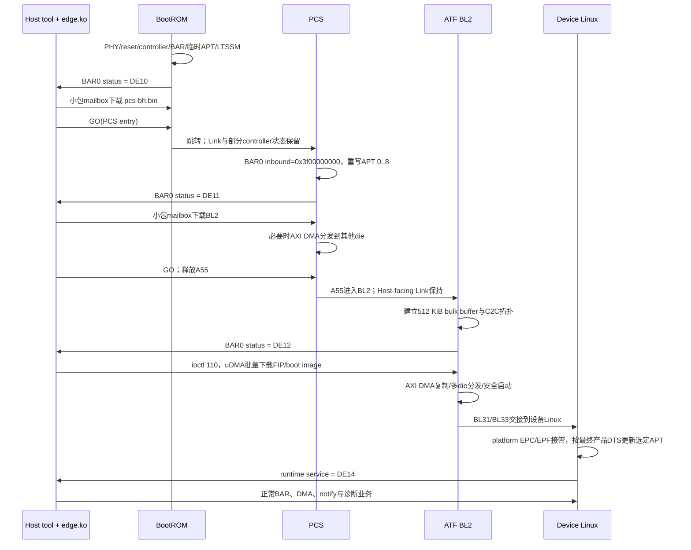

# X6000 PCIe 启动交接：同一条 Link，四拨软件轮流接班

> 适用代码版本见 [代码仓来源索引](SOURCE_REPOSITORY_INDEX.md)。本文把 BootROM、PCS、
> ATF BL2、设备 Linux 与 Host 工具放在同一条时间线上。它重点回答的不是“各阶段调用
> 了哪个函数”，而是：**前一阶段留下了什么硬件状态，后一阶段相信了什么，又覆盖了什么。**

## 1. 先建立直觉：PCIe Link 不是每换一段固件就重新插一次卡

X6000 从 PCIe 下载启动时，外部 Host 已经枚举了这个 Endpoint（EP，PCIe 端点）。
BootROM 把 PHY 和 Link 拉起来、让 BAR0 可访问；PCS、BL2 和 Linux 随后在同一颗芯片
上接班。理想情况下 Host 不必在每个阶段重新枚举设备，只需观察 BAR0 中的阶段 magic：

```text
DE10 → BootROM ready
DE11 → PCS ready
DE12 → ATF BL2 ready
DE14 → Linux runtime ready
```

这里很像一间 24 小时营业的机房：网线一直插着，值班人员换了四班；麻烦在于每班人
会重新贴门牌（APT），却还沿用同一扇大门（BAR0）。

## 2. 端到端时间线



这张图有意把 Host 画成贯穿全程的参与者。设备侧固件换了，Host 的 `edge.ko` 和
`edge10_tool` 并没有跟着重启；阶段 magic 正是两边避免“鸡同鸭讲”的最小协议。

## 3. 硬件状态所有权矩阵

符号：`创建` 表示本阶段第一次建立；`继承` 表示依赖前态且通常不重做；`覆盖` 表示
明确重新编程；`消费` 表示使用但不拥有配置；`未证实` 表示六仓源码不足以确认。

| 状态/资源 | BootROM | PCS | ATF BL2 | Device Linux | Host Linux/tool |
|---|---|---|---|---|---|
| Host-facing PHY/refclk/reset | 创建 | 继承 | 继承 | probe 中 init/power，但 EP 不完整重训 | 观察 Link |
| RC/EP mode、lane、speed | 创建 | 继承 | 继承 | EP platform path 不重新设置 | 枚举后读取能力/状态 |
| LTSSM / Link Up | 创建并等待 | 继承已在线 Link | 继承 | 主要接管现状 | Link Down/hot reset 可破坏它 |
| Function vendor/device/BAR形态 | 创建 | 可能修补 hot-reset 后 BAR | 继承/按产品配置 C2C | EPF/configfs 可重写运行期 header/BAR | PCI core 枚举并分配地址 |
| BAR0 inbound base | Boot阶段临时目标 | 覆盖为 `0x3f00000000` | 沿用并补C2C | EPC `set_bar()`使用同一类 aperture | BAR resource 是 Host PCI 地址 |
| SoC APT | 临时 7 region | 覆盖为下载用 0..8 | 按C2C/下载补写 | 最终产品DTS更新选定region，并依赖部分前态保留 | 通过BAR间接消费 |
| SRAM mailbox | 创建 DE10 | 复用，改 DE11 | 复用控制消息，改 DE12 | runtime协议另行接管，改 DE14 | 按 magic 选择 ioctl 通道 |
| 512 KiB bulk buffer | 无 | 无 | 创建/消费 | 非启动主通道 | ioctl 110 + uDMA写入 |
| Host-facing uDMA | 未用于小包 | 管理路径可能使用远端uDMA | 用于bulk H2D | runtime controller IRQ/setup | `edge.ko`远程编程并排队 |
| MSI/MSI-X table | 末期分支含实验 | VF/FLR骨架 | 消费Host写入表，做C2C relay | EPF发布table、EPC发/捕获 | PCI core写表并分配49 vector |
| C2C A8 RC ↔ B0 EP | 无 | 部分多group管理 | 创建/最小枚举/relay | RC/EP driver继续运行时管理 | Host只看到其聚合结果 |
| IOMMU/SMMU | 无证据 | 无证据 | 未配置 | 取决于DTS/平台；仍需专项实机确认 | Host DMA API可能给IOVA |
| AER/error recovery | 极简状态 | PM/FLR实验 | misc/FIQ/firewall | controller + PCI core | `edge.ko` AER callbacks/hot reset |

最重要的阅读原则是：**“Linux 驱动支持配置某寄存器”不等于“Linux 每次都从零配置
该寄存器”。** X6000 EP platform probe 对 mode/speed/lane 的处理，和 RC probe 并不
对称，正说明固件交接是设计的一部分。

## 4. BootROM：先把最小可下载设备变出来

BootROM 的责任是把一颗刚上电、Host 完全看不见的芯片，变成一个可被配置读写、
BAR0 可命中的 EP：

```text
power/reset/refclk
 → PHY与controller基本配置
 → vendor/device、BAR能力
 → 临时inbound ATU/APT
 → enable LTSSM
 → Link L0 / DL_Up
 → Host enumeration
 → AP SRAM status = DE10DE10
```

Host 写 `BAR0+0x7fb00` 时，产生 Posted Memory Write TLP；EP BAR0 命中后落到
`0x6007fb00`。Host 再写 `BAR0+0x7fa00 = 1`，BootROM 轮询本地 SRAM 就能看到。
这一阶段没有必要搬出 DMA 大炮：小包 mailbox 足够可靠，也更容易在早期环境调试。

BootROM master 不在 `GO` 前清除 BAR0 inbound；这使通道可跨阶段保持。旧
`pcie_second_boot` 分支曾清除该窗口，详见[分支矩阵](bootrom_pcie_branch_matrix.md)。

## 5. PCS：保持 Link，换掉 BAR 后面的地图

PCS 并不重新演一遍完整建链流程。它保留 BootROM 已经在线的 Host-facing Link，
把 BAR0 inbound base 设置为 `0x3f00000000`，清理/重写 APT 0..8，然后将状态改为
`DE11DE11`。

这带来一个非常工程化的约束：重写 APT 时 Host 必须安静。源码没有看到围绕每个
APT register update 的强制总线握手，安全性依赖工具只在识别到新 magic 后访问新
布局。若 Host 正在对被改写的 offset 做 MMIO，TLP 可能命中旧目标或新目标——这种
问题的复现概率往往很有“玄学气质”，但原因并不玄学。

PCS 仍复用四个 SRAM 地址：

| 本地地址 | BAR0 offset | 用途 |
|---:|---:|---|
| `0x6007fa00` | `0x7fa00` | Host→Device ready |
| `0x6007fa40` | `0x7fa40` | 阶段 status magic |
| `0x6007fa80` | `0x7fa80` | Device→Host ready |
| `0x6007fb00` / `0x6007fd80` | 同低位 | 双向小包 buffer |

对于多 die，PCS 可先收一份 BL2，再用芯片内部 AXI DMA 分发。这里的 AXI DMA 与
PCIe uDMA 是两台不同的搬运器：前者在 SoC 地址空间内搬，后者会生成 PCIe TLP。

## 6. ATF BL2：控制包仍小，镜像数据改走 bulk uDMA

BL2 把 magic 改成 `DE12DE12`。控制消息仍走小 mailbox，但 FIP/boot image 改用
512 KiB bulk buffer：

```text
Host user buffer
 → dma_map_sg()/coherent block，得到Host DMA address或IOVA
 → edge.ko通过BAR0写EP uDMA descriptor
 → EP uDMA发Memory Read Request TLP
 → Host内存返回Completion with Data
 → EP DDR 512 KiB staging buffer
 → BL2检查header/CRC
 → 本地AXI DMA复制到目标地址/其他die
```

所以“Host→Device”并不意味着 Host 发 Memory Write：当前 bulk 实现由 Endpoint
主动读 Host memory，线上的主请求是 **Memory Read**，数据跟在 **CplD** 里回来。
名字看业务方向，TLP 要看谁是 Requester；这两个视角经常把初学者绕晕。

BL2 同时建立 A8 RC→B0 EP 的 C2C（chip-to-chip）最小拓扑，包括 config aperture、
BAR、outbound region、APT 和 MSI-X relay。Host-facing A0 是对外 Function，B0 并非
Host 直接枚举的 Function，因此 B0 的通知需要 A8/A0 中继。

## 7. Device Linux：从启动通道切到运行期控制面

设备 Linux 的 Cadence platform/EPC/EPF 栈接管运行期状态。公共Ultra DTSI提供模板，
具体A/B、LM/DS产品DTS再覆盖`apt-ranges`。EPC `set_bar()`只更新列出的region，未清
全表，因此AP SRAM/mailbox等窗口继续依赖固件保留；运行期不是“Linux从零重画整张图”。
完整表见[统一地址地图](x6000_address_map.md)。

这里存在一处仍需部署证据验证的交接：主 EPC driver 创建 controller，却没有在
六仓中找到创建/bind/start `pci_epf_edge` 的 configfs 脚本。Host driver 要求最多
49 个 MSI-X vector；EPF 的 `msix_interrupts` 必须由外部配置到相应数量。脚本很可能
在 rootfs/产品部署仓，而不是当前六仓。这个缺口不能靠“看起来应该如此”偷偷补上。

## 8. Host 侧怎样知道该用哪套协议

`edge10_tool` 不直接碰硬件，它经 HAL 调 `edge.ko` ioctl。HAL 先查询 boot state，
再根据 magic 选择通道：

| 阶段 | magic | HAL控制通道 | 大数据通道 |
|---|---|---|---|
| BootROM | DE10 | ioctl 4/5，小mailbox | 无 |
| PCS | DE11 | ioctl 4/5，小mailbox | 无 |
| BL2 | DE12 | ioctl 11/12控制消息 | ioctl 110 uDMA bulk |
| Linux | DE14 | runtime协议 | 正常uDMA/BAR2/shared memory |

magic 不是装饰性日志，而是跨启动阶段 ABI 的版本选择器。若 magic 非法却继续 mmap
或 DMA，工具可能把一段完全合法的 BAR offset 当成错误阶段的协议结构，这比直接
报错更危险，因为它往往“能读到数，只是数不对”。

## 9. Link、Hot Reset、FLR：哪些操作会破坏阶段交接

- **FLR（Function Level Reset）**：只复位某 Function 的协议状态，不应被当成整条
  Link 重训。BootROM/PCS末期分支含 FLR/MSI-X实验，Linux/Host还要重新确认BAR、BME
  和业务队列状态。
- **Hot Reset**：作用于整条下游 Link。PCS 有针对 reset 后 BAR 配置回默认值的修补；
  Host 工具也有 bridge secondary-bus reset 路径。
- **Link Down**：所有依赖该 Link 的 transaction、outstanding read、uDMA和中断都要
  视为失效。双 group 板卡只重启半张卡，还会让 C2C 另一端进入半失联状态，因此工具
  默认阻止这种操作。

恢复不能只看“LTSSM 又回 L0”。至少要重新验证：

```text
DL_Up
 → Function config/BAR仍有效？
 → APT/outbound region属于哪个阶段？
 → BME/MSI-X Enable与table内容仍有效？
 → uDMA queue/descriptor是否已清空？
 → C2C枚举与relay是否恢复？
 → 当前magic与Host协议是否一致？
```

## 10. 阶段化 Debug 路线

### 卡在 DE10 之前

先查电源/refclk/reset/PHY，再查 LTSSM、lane/width/speed 和 DL_Up；之后才轮到 Host
枚举、Vendor ID、BAR allocation 与 Memory Space Enable。

### 停在 DE10

Link和枚举大概率已成立。检查 BAR0 inbound、`0x7fa00/0x7fb00` mailbox、packet CRC、
GO地址，以及 Host是否错误地提前使用BL2 bulk通道。

### 停在 DE11

检查 PCS APT enable、region 0..8、BL2镜像长度与AXI DMA分发。读同一 BAR offset 前，
必须按 PCS 地图解释，不能套 Linux Ultra DTS。

### 停在 DE12

检查 Host DMA mapping、uDMA descriptor、channel mask、EP outbound ATU、Memory Read/
CplD、512 KiB buffer边界和CRC。若只有某个die失败，再转查C2C和AXI DMA分发。

### 到 DE14 后业务失败

启动已经不是第一嫌疑。改查 Linux runtime APT、49-vector MSI-X、notify ring、DMA
queue、IOMMU/IOVA、AER与产品/组别窗口选择。

## 11. 已确认、推断与证据缺口

**Confirmed**：四阶段 magic、小mailbox地址、PCS重写APT、BL2 bulk uDMA、最终产品
DTS选择性APT更新、Host ioctl分流都被当前源码直接支持。

**Inferred**：Device Linux EP probe 依赖固件保留 mode/lane/speed/Link，因为其EP路径
没有像RC路径那样完整重做这些配置；这是强源码推断，但仍应以启动log/寄存器trace验证。

**NEED_VERIFY**：EPF configfs创建/start脚本、实际产品的MSI-X advertised count、
外部Host IOMMU/IOVA策略，以及Hot Reset/Link Down后当前RTL究竟保留哪些
local-management字段。设备Linux defconfig本身已确认关闭IOMMU。余项已同步到开放
问题，不会在架构图里假装成既定事实。

## 12. Source Reference

- BootROM：`src/driver/pcie/pcie.c`、`src/driver/pcie/pcie_mkfw.c`、
  `src/driver/pcie/pcie_download.c`，以及各分支 tip；详见分支矩阵。
- PCS：`board/edge10/main/pcie.c`、`pcie_init.c`、`smbus_group.c`。
- ATF：`drivers/intellif/pcie/pcie.c`、`pcie_init.c`、`pcie_irq_relay.c`，
  `plat/intellif/edge10/edge10_bl2_setup.c`、`edge10_multi_die.c`。
- Device Linux：`drivers/pci/controller/cadence/pcie-edge-{plat,ep,host}.c`、
  `drivers/pci/endpoint/functions/pci-epf-edge.c`、
  `arch/arm64/boot/dts/intellif/hsio/edge10_ultra_hsio_pcie_card.dtsi`。
- Host：edge-driver `pcie/edge.c`；edge10_tool `src/host/cases/pcie/boot.c`；HAL
  `host/communication/pcie/hal_pcie.c`。
