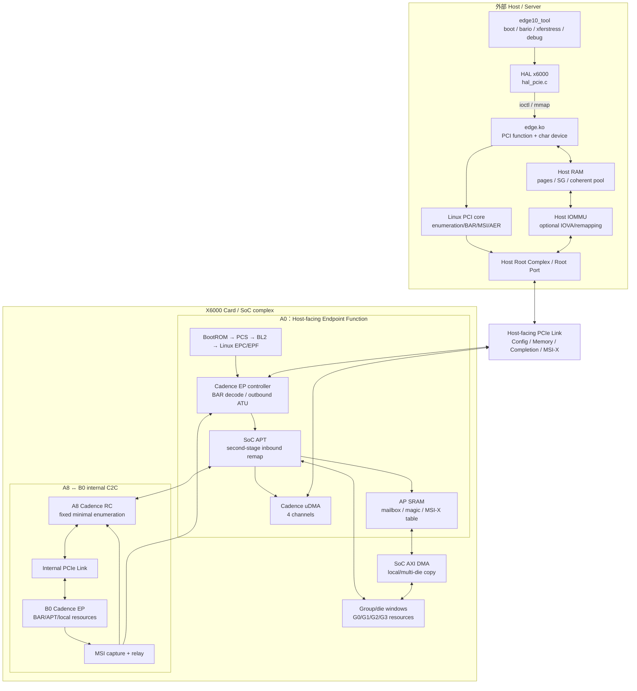
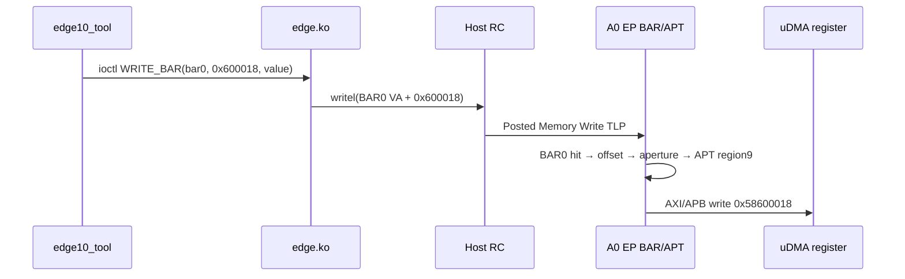
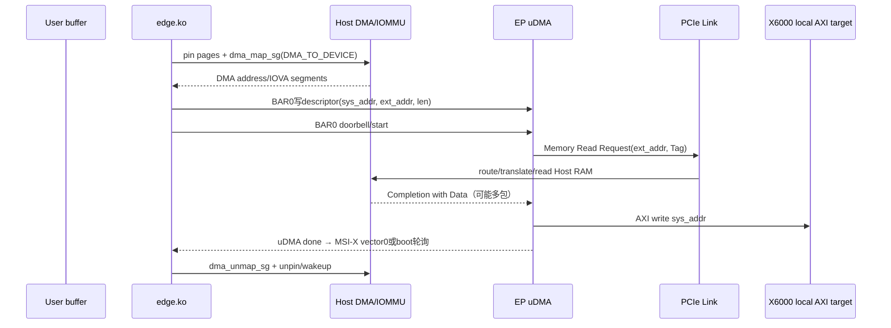
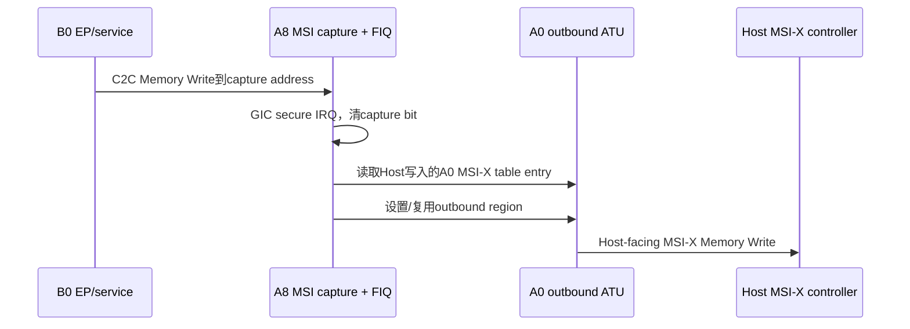

# X6000 PCIe 综合架构：从 Host 命令到 A0/A8/B0、DMA 与中断

> 本文是六仓研究的汇合点，不替代各仓专题。第一次读可以顺着“总体图→四条真实路径→
> 阅读路线”走；调试时则直接查所有权、地址或故障边界。

## 1. 一句话结论

X6000 PCIe 不是“设备 Linux 里有一个 PCI 驱动”这么简单。它是一套跨 Host 用户态、
Host 内核、外部 Root Complex、X6000 对外 Endpoint、板内 C2C Root Complex/Endpoint、
四级启动软件和多 die/group 地址翻译共同维护的系统。

其中最反直觉的一点是：**Host `edge.ko` 会通过 BAR0 远程编程 Endpoint 内部的 Cadence
uDMA。** 因此驱动虽跑在 Host Linux，它控制的 DMA engine 却在 X6000 设备里。

## 2. 总体物理与软件架构



图中有两台名字都带 DMA 的搬运器：

- **Cadence PCIe uDMA**：一端是X6000本地AXI，另一端是PCIe地址；会产生Memory
  Read/Write TLP。
- **SoC AXI DMA**：在芯片内部地址空间搬运，用于PCS/BL2多die分发；本身不等于
  一笔Host-facing PCIe transaction。

把它们混成“DMA模块”会让descriptor、地址域和中断全都对不上。

## 3. 五层软件栈怎样对接

```text
edge10_tool command
  ↓ public HAL API
HAL x6000 implementation
  ↓ ioctl / mmap / read / write
Host edge-driver (edge.ko)
  ↓ Linux PCI API + BAR MMIO + DMA API
Host PCI core / DMA subsystem / IRQ domain / AER
  ↓ host bridge transaction
PCIe Link
  ↓
X6000 A0 Cadence EP + APT + SRAM/uDMA
  ↓ optional C2C
A8 RC → B0 EP → local die/group resource
```

各层主要职责：

| 层 | 知道什么 | 不应偷偷承担什么 |
|---|---|---|
| CLI | 产品、group、测试意图、镜像顺序 | 不直接猜BAR物理地址 |
| HAL | ioctl ABI、mmap offset、boot stage | 不绕过驱动管理DMA mapping |
| edge.ko | `pci_dev`、BAR resource、MSI-X、Host DMA address、uDMA队列 | 不把IOVA当CPU地址 |
| PCI core/platform | 枚举、资源、BME/MSE、IRQ/AER、IOMMU | 不理解X6000 mailbox业务协议 |
| EP firmware/Linux | BAR后端、APT、uDMA/MSI capture、C2C | 不分配Host BAR resource |

## 4. 设备如何“出现”：配置与枚举路径

BootROM先让A0 EP的PHY、LTSSM、Function config和BAR能力有效。Host启动或rescan时：

```text
Host PCI core
 → Root Port发Configuration Read Type 0
 → A0返回Vendor/Device = 17cd:0100（或2000）
 → Host写全1探测BAR mask
 → Host resource allocator选择PCI地址范围
 → Host写BAR base，置Command.MSE
 → 解析MSI-X/AER等Capability
 → 创建struct pci_dev
 → ID匹配edge_pci_tbl
 → edge_probe()
```

这里有两个常被混淆的“地址配置者”：

- Host PCI core给BAR分配**Host PCI address**；
- X6000固件/Linux配置BAR命中后去往哪个**EP local aperture/AXI target**。

前者不知道`0x6007fa40`，后者也不能决定Host究竟把BAR0放在`0x80000000`还是别处。

`edge_probe()`随后启用设备、设置DMA mask、请求region、映射BAR、启用BME、建立49个
MSI-X vector（若能力允许）、创建四条uDMA engine和字符设备。Host tool的`scan`
是在这些PCI设备已经被内核发现之后做产品身份/持久编号管理，不是重新实现PCI枚举。

## 5. 路径一：一次普通 BAR 寄存器写

以工具写runtime uDMA寄存器为例；此处ioctl offset取`0x600018`：



Memory Write是Posted Request：成功路径没有Completion。`writel()`返回通常只说明
Host把写交给了I/O系统，不能证明远端业务逻辑已经执行。因此mailbox需要ready flag，
doorbell之后的业务完成需要DMA completion/MSI或轮询状态。

若改成`readl()`，RC发Memory Read（Non-Posted），EP必须返回CplD；Completion Timeout、
Unsupported Request和全1读值便在这条路径上出现。

## 6. 路径二：Host→Device uDMA（H2D）

业务方向是Host到Device，但Requester是EP：



关键字段：

- descriptor `ext_addr`：Host DMA address/IOVA；
- descriptor `sys_addr`：X6000本地AXI target；
- PCIe Requester ID：A0 Function身份；
- Tag：匹配返回的Completion；
- MRRS/MPS：决定Read Request及CplD切包；
- Host IOMMU：若启用，用Requester身份和IOVA决定能否访问Host page。

BL2 bulk download也是这条路径，只是目标是固定512 KiB staging buffer，完成通常允许
轮询，随后BL2再用AXI DMA把数据送到镜像最终地址。

## 7. 路径三：Device→Host uDMA（D2H）

```text
edge.ko dma_map_sg(DMA_FROM_DEVICE)
 → descriptor: sys_addr = EP local source, ext_addr = Host DMA address
 → BAR doorbell启动EP uDMA
 → uDMA从local AXI读取
 → 发Posted Memory Write TLP到Host
 → Host RC/IOMMU写Host RAM
 → uDMA完成状态/MSI-X vector0
 → dma_unmap_sg，使CPU按平台规则重新看到数据
```

D2H主数据是Posted Memory Write，没有逐笔Completion。可靠性由链路层LCRC/replay、
Flow Control、接收侧错误机制和DMA engine完成状态共同保证，而不是由Transaction Layer
为每个Memory Write返回确认事务。

Host driver把H2D映射成`DMA_TO_DEVICE`、D2H映射成`DMA_FROM_DEVICE`，这里“device”
指真正执行DMA的X6000 EP，而不是运行驱动代码的Host CPU。

## 8. SG、coherent block、BAR2 MMIO：三种测试不要混读

| edge10_tool模式 | Host存储 | 跨PCIe发起者 | 测到的主要开销 |
|---|---|---|---|
| SG uDMA | pin用户页 + `dma_map_sg` | EP uDMA | pin/map、descriptor、TLP、completion |
| block uDMA | `dma_alloc_coherent` pool | EP uDMA | 更接近uDMA本体；用户copy常在计时外 |
| BAR2 mmap/MMIO | PCI BAR映射 | Host CPU | CPU copy、MMIO read completion或posted write |
| P2P | peer BAR/DMA address | 某个EP | peer route、ACS/IOMMU/topology限制 |

`bwmon`按uDMA channel的byte/timestamp计数，不统计普通BAR2 `memcpy`，因此不能用它
解释MMIO带宽。工具本身没有问题，但它观测的是另一条数据路径。

## 9. 路径四：MSI-X与跨C2C中继

### 9.1 Host-facing A0直接通知

Host枚举后在A0 BAR0+`0x2c000`写MSI-X table entry：message address、message data、
vector control。EP读取entry，建立outbound region，然后向message address发一笔
32-bit Memory Write；Host interrupt remapper/IRQ domain将其送到Linux handler。

Host driver的vector布局：

```text
vector 0      uDMA completion
vector 1..24  group 0 notify channel 0..23
vector 25..48 group 1 notify channel 0..23
```

MSI-X不是一根额外物理中断线，而是一笔有特定地址/数据的Memory Write TLP。

### 9.2 B0通知为何需要A8/A0 relay



B0不是Host直接枚举到的Function，不能直接假设自己拥有Host给A0分配的MSI-X身份和
table。BL2的relay把B0 event转成A8捕获中断，再借A0对外写出。notify索引加25，正好
落在Host driver后24个vector区间。

这个路径失败时必须分三段查：B0是否写出、A8是否capture/FIQ、A0是否读取正确table
并向Host写出。只看Host的`/proc/interrupts`，最多只能证明最后一段没发生。

## 10. 启动控制面与运行期控制面

```text
BootROM DE10  小mailbox → 下载PCS
PCS     DE11  小mailbox → 下载BL2/多die分发
BL2     DE12  小控制包 + 512 KiB uDMA bulk → FIP/boot
Linux   DE14  runtime mailbox/notify/uDMA/BAR2/P2P/debug
```

完整寄存器交接见[启动交接与所有权](x6000_boot_handoff_and_ownership.md)，不同阶段
的BAR/APT表见[统一地址地图](x6000_address_map.md)。

## 11. Link、错误与恢复架构

### 11.1 先确定是哪条Link

```text
Host-facing: Host Root Port ↔ A0 EP
Internal C2C: A8 RC ↔ B0 EP
```

外部`lspci`能直接反映第一条，不能自动证明第二条。A8/B0要查BL2/Linux controller
status、config aperture Vendor ID、内部LTSSM和relay状态。

### 11.2 错误传播

```text
TLP/Link/PHY fault
 → Cadence status / AER / completion status
 → local misc/error/DMA IRQ
 → Device firmware/Linux记录或relay
 → PCIe Error Message到Host Root Port（若适用）
 → Host AER service
 → edge.ko error_detected / slot_reset / resume
 → user-visible ioctl failure/log
```

常见归类：

| 现象 | 先查层次 | 典型含义 |
|---|---|---|
| Vendor ID全1 | Link/config routing | Config request无有效Completion |
| BAR read全1/CTO | 地址/transaction | BAR/MSE/APT/target未响应 |
| Unsupported Request | transaction decode | TLP类型/地址/Function不支持 |
| uDMA status error | DMA/ATU/IOMMU | descriptor、IOVA、permission、Cpl status |
| MSI-X计数不涨 | table/outbound/IRQ | vector mask、BME、relay、irq mapping |
| Surprise Down | Link/电源/reset | 整条Link状态被破坏 |

### 11.3 恢复顺序

合理顺序是先恢复承载关系，再恢复业务：

```text
停止新任务/冻结queue
 → 确认Link和Data Link恢复
 → 恢复Function config、BAR、MSE/BME
 → 恢复APT/outbound region
 → 恢复MSI-X table/capture/relay
 → 清理旧descriptor与outstanding read
 → 恢复runtime magic/协议
 → 再放开用户任务
```

`edge.ko`已有AER callbacks和hot-reset路径，但源码审计发现等待DMA drain可能在硬件冻结
时卡住；恢复设计应有有界超时和强制abort路径。

## 12. 多仓库ABI：真正把系统绑在一起的契约

| ABI/契约 | Producer | Consumer | 破坏后的表现 |
|---|---|---|---|
| `17cd:0100/2000` ID | EP config固件/EPF | Host PCI core/edge.ko | driver不probe |
| BAR尺寸/布局 | BootROM/PCS/Linux EPC/EPF | Host allocator/edge.ko/HAL | mmap或寄存器offset错误 |
| DE10–DE14 magic | 各device stage | edge.ko/HAL/tool | 选错下载协议 |
| mailbox地址/ready语义 | 固件 | Host HAL/driver | 双方永久等待/覆盖包 |
| ioctl号与结构体layout | edge.ko header | HAL x6000 | 参数错位、内存破坏 |
| uDMA descriptor格式 | Cadence硬件 | edge.ko/PCS/BL2/Linux | DMA error或错地址 |
| MSI-X table offset/vector分区 | EPF/固件 | Host PCI core/edge.ko/relay | IRQ错投或丢失 |
| APT region编号/target | DTS/固件 | driver/tool/debug脚本 | BAR命中错误资源 |
| product/group/die编码 | eFuse/firmware | tool/driver/relay | 操作错误半卡/窗口 |

这也是为什么升级不能只问“某个仓库能不能编译”：跨仓ABI往往比单仓编译器更早发现
你改错了，只是它发现问题的方式通常是一张卡沉默地不启动。

## 13. 推荐源码阅读路线

### Stage 1：先认清系统边界

阅读：

1. 本文第2、3节；
2. `edge_driver_x6000.md` 第1–4节；
3. `linux_x6000_pcie_stack.md` 第1–4节。

学完应能回答：Host driver为何能控制EP DMA？EPC、EPF、`edge.ko`分别是谁？

### Stage 2：跟一次上电与枚举

阅读：BootROM专题→分支矩阵→启动交接第1–5节→Linux stack的probe/EPF。

源码顺序：BootROM `pcie_mkfw.c` → PCS `pcie_init.c` → Linux
`pcie-edge-plat.c` / `pcie-edge-ep.c` / `pci-epf-edge.c`。

学完应能回答：一个刚上电的A0怎样变成Host的`struct pci_dev`？

### Stage 3：吃透地址

阅读：[统一地址地图](x6000_address_map.md)，然后对照Ultra DTS、EPC `set_bar()`、
Host `pci_iomap()`和`mmio_xfer()`。

练习：任选`BAR0+0x7fa40`、`+0x400018`、`+0x600018`、`+0x800018`，
写出六段地址转换，并说明哪些region由固件保留、哪些由最终产品DTS更新。

### Stage 4：跟H2D/D2H uDMA

源码顺序：tool `xferstress.c` → HAL `hal_pcie.c` → edge.ko ioctl → descriptor builder/
submit/ISR → Cadence uDMA文档 → optional IOMMU。

学完应能回答：为什么H2D在线上是Memory Read？`dma_map_sg()`返回值写到哪里？

### Stage 5：跟一次MSI-X

源码顺序：EPF MSI-X capability → Host vector allocation → A0 send MSI-X → edge ISR；
再读ATF `pcie_irq_relay.c`理解B0→A8→A0→Host。

### Stage 6：跟完整启动下载

tool `boot.c` → HAL boot API → edge.ko boot ioctl → BootROM/PCS mailbox → BL2 bulk →
AXI DMA多die分发。把每个magic、buffer和搬运器写在纸上，通常一页纸就能抓出阶段错配。

### Stage 7：做错误与恢复

选三类故障：拔Link、破坏APT、给uDMA错误IOVA。分别记录Endpoint寄存器、Host AER、
IRQ、ioctl返回和工具现象，建立产品自己的故障签名库。

## 14. 工程审计中最值得优先处理的风险

这些是静态源码发现，不等于已在实机复现；优先级按潜在影响排序：

1. BL2 bulk长度越界只打印仍继续，极短未对齐长度还可能无符号下溢。
2. HAL构建脚本动态checkout/pull同名分支，release不一定由主仓gitlink唯一决定。
3. EPF configfs创建/start和49-vector实际配置在六仓中缺失，部署依赖不可追溯。
4. Host MSI fallback路径的Linux IRQ与entry索引存在混用风险。
5. AER恢复等待DMA completion缺少可靠的硬件冻结逃生路径。
6. HAL非页对齐BAR2 mmap返回page base，未加page offset。
7. 工具产品识别失败仍可能mmap BAR2 offset 0；group id 2也能通过部分校验。
8. Linux EPC capability使用全局可变结构，多个group probe可能相互污染reserved BAR。
9. APT动态改写的跨访问者锁与阶段静默主要靠协议约定，需要明确owner。
10. 设备Linux defconfig明确关闭IOMMU；外部Host的IOMMU/IOVA策略仍需实机确认。

风险细节与具体函数见各仓专题，不在这里重复抄代码。

## 15. Source Reference 与专题导航

- [代码仓来源索引](SOURCE_REPOSITORY_INDEX.md)
- [Host edge-driver](edge_driver_x6000.md)
- [Device Linux PCIe栈](linux_x6000_pcie_stack.md)
- [BootROM主流程](bootrom_pcie_boot_flow.md)与[21分支矩阵](bootrom_pcie_branch_matrix.md)
- [PCS阶段](pcs_x6000_pcie_stage.md)
- [ATF BL2阶段](atf_x6000_pcie_stage.md)
- [edge10_tool与HAL](edge10_tool_x6000_host.md)
- [启动交接与所有权](x6000_boot_handoff_and_ownership.md)
- [统一地址地图](x6000_address_map.md)

核心源码入口：

- Host：edge-driver `pcie/edge.c`；tool `src/host/cases/pcie/`；HAL
  `host/communication/pcie/hal_pcie.c`。
- Device Linux：`drivers/pci/controller/cadence/pcie-edge*.c`、
  `drivers/pci/endpoint/functions/pci-epf-edge.c`、Ultra PCIe DTSI。
- Firmware：BootROM `src/driver/pcie/`；PCS `board/edge10/drivers/pcie/`；ATF
  `drivers/intellif/pcie/`与`plat/intellif/edge10/`。
