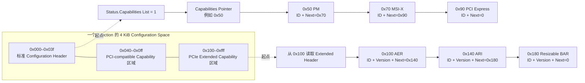
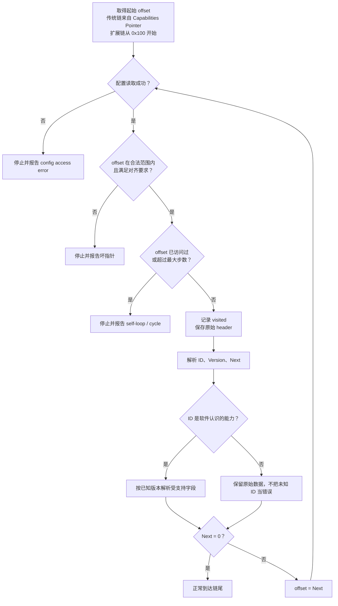
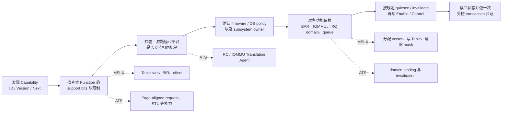

# Capability：如何发现设备支持的可选能力

## 1. 为什么不是一个固定大结构体

PM、MSI-X、AER、ATS、SR-IOV 并非每个 Function 都实现。PCIe 用可遍历 capability 结构让硬件按需组合；软件先发现 capability，再按版本/能力位决定能否启用。

## 2. 两类 Capability 链表

| 类型 | 地址范围 | header/next | 常见能力 |
|---|---|---|---|
| PCI-compatible Capability | `0x40–0xff` | 8-bit ID + 8-bit next pointer | PM、MSI、MSI-X、PCI Express |
| PCIe Extended Capability | `0x100–0xfff` | 16-bit ID + 4-bit version + 12-bit next offset | AER、ACS、ARI、ATS、SR-IOV、L1SS、PASID、PRI |

先用一张图建立整体位置感。下面的 offset 只用于展示遍历方法，并不是所有设备都采用这些地址：

上半条链的起点来自标准 Header 中的 Capabilities Pointer；下半条链没有单独的起始指针，软件直接检查 `0x100`。两条链最终都依赖各节点的 `next` 字段，而不是依赖能力名称或固定排列顺序。

传统链从 Status.Capabilities List 和 Header 的 Capabilities Pointer 开始。Extended Capability 通常从 `0x100` 检查 header，再跟 next pointer。next=0 表示链尾；offset 应满足规定对齐/范围。

这里有个很细、却很适合拿来制造 walker bug 的区别：

- **链尾**：最后一个真实 Extended Capability 保留自己的非零 ID/version，只把 `Next Capability Offset` 设为 `000h`；
- **Configuration Space 根本没有 Extended Capability**：offset `0x100` 的 header 应为 ID=`0000h`、version=`0`、next=`000h`；
- **RCRB（Root Complex Register Block）根本没有 Extended Capability**：起始 header 使用 ID=`ffffh`、next=`000h`。

所以 `ffffh` 不是普通 Function 配置空间的“标准空链”编码。2010 年王齐教材第 4.3.3 节把 Configuration Space 的无能力情形写成 ID=`ffffh`，与 PCIe 5.0 §7.6.1/7.6.2 不同；它更像是把 RCRB 的规则搬错了房间。实现时听现行规范的，别让一本老书替硬件投票。

## 3. 安全 walker 要防坏链

真实硬件/仿真模型可能给出：越界、未对齐、next 指向自身、环、全 1 config read。walker 应：

1. 检查 config access 成功；
2. 校验 offset 范围与对齐；
3. 设最大遍历次数或 visited bitmap；
4. 解析 ID 前保存原始 header；
5. 不因未知 ID 停止，按 next 继续；
6. 同一 ID 可能有多个 instance，不能只假定一个。

Linux driver 应优先使用 `pci_find_capability()`、`pci_find_next_capability()`、`pci_find_ext_capability()` 等 PCI core API，不自己写脆弱链表循环。

安全 walker 的控制流程可以概括为：每走一步，先证明当前 offset 值得信任，再解释 header。顺序不要反过来。

这张图里最重要的不是“认识多少个 ID”，而是三条退出路径：配置访问失败、指针非法、链形成环。未知 ID 本身不是退出理由；只要 header 和 next 合法，walker 就应继续前进。

## 4. 能找到不等于能直接用

发现 capability 后仍要检查：

- capability version 和具体 support bits；
- 上游 path 是否也支持/enable，例如 ARI/ATS/ACS；
- firmware/OS policy 与 ownership；
- 设备当前 power/reset 状态；
- enable 前后所需 quiesce/invalidate/barrier；
- Linux subsystem 是否已拥有该 capability。

例如找到 MSI-X 只能证明 table/PBA 描述存在；Host 还要分配 vector、写 table、解 mask 并建立 irq-domain。找到 ATS 也不代表设备可随意缓存 translation；IOMMU 与 invalidation protocol 必须共同就绪。

因此，“发现 capability”和“功能可以安全工作”之间还有一条完整的准备链：

图中的横向主链适用于多数可选能力；虚线分支说明不同 capability 的准备内容并不相同。通用 Function driver 不能只找到一个 offset、置一个 Enable bit，就认为平台其余部分会自动就绪。

反过来，真正的 **PCIe device Function 必须实现 PCI Express Capability**，其 Status.Capabilities List 位也必须硬连为 1。某个可选寄存器组可以不实现，某项 Extended Capability 也可以缺席，但“这是 PCIe Function，却连 ID `0x10` 的 PCI Express Capability 都没有”不是正常的精简配置。若扫描不到它，应先怀疑配置访问、链指针、设备类型或硬件实现。来源：Base Spec 5.0 §§7.5.1.2、7.5.3。

## 4.1 版本号是为了向前兼容，不是为了把新设备赶走

2003年教材里的PCI Express Capability只画到Device/Link/Slot/Root第一组寄存、Extended Capability也只列AER、VC、DSN、Power Budgeting四种。PCIe 5.0的Capability version 2已增加Device/Link/Slot Capabilities/Control/Status 2，Extended Capability ID更是长了一大串。

通用software因此应：

- 先按ID找structure，再按version和support bit解释已知字段；
- 对比自己更新的version保留已知前缀的兼容解析，不要因为“version不等于1”就整块拒绝；
- 对未知Extended Capability ID，仍用next pointer继续走链；
- 不把某本书或某一个 build 的 capability 列表当成所有 PCIe 实现都具备的固定集合。

一个具体年代标记是Tag：旧教材只讲5-bit/8-bit Extended Tag，PCIe 4.0开始又引入10-bit Tag，其Requester/Completer support和enable位在Device Capabilities/Control 2。把旧表拉到Gen4/Gen5硬件上照抄，会直接丢掉新的outstanding request能力。

## 5. Cadence 固定 offset 的正确用法

生成式 Cadence manual 会列出本 build 的 capability 默认 offset/next pointer，例如某 VF map 中 PM、MSI、MSI-X、PCIe、AER、ARI 的位置。它适合：

- RTL/firmware 初始化和 coverage 对照；
- 验证 capability 链是否按 build 连接；
- 定位 local APB config register。

它不适合让通用 Linux Function driver 硬编码 offset。换一个 Cadence configurator output，capability surface/顺序就可能变化。

下面是 Cadence Databook 给出的 capability linked-list 实现图。它很好地展示了两点：传统 Capability 与 Extended Capability 被接在同一套配置空间实现中；ARI、SR-IOV、Resizable BAR、代际相关能力等节点还可能根据静态配置被旁路。

> 图源：Cadence *PCIe Core User Guide*，Appendix H，Figure H.1，PDF p.1458 / printed p.1369。虚线旁路表示相应能力未选中时，链表指针跳到下一个有效节点。这是一张实现结构图，不等于当前 X6000 芯片一定启用了图中的全部能力；实际结果仍以 configuration-specific table 和实机 config dump 为准。

## 6. 建议的 capability dump 表

| BDF | offset | ID/version | next | enabled | path prerequisite | owner |
|---|---:|---|---:|---|---|---|
| `01:00.0` | `0x...` | MSI-X | `0x...` | yes/no | BAR table可达 | PCI MSI core |
| `01:00.0` | `0x...` | AER v2 | `0x...` | masks | Root Port service | AER core |
| `01:00.0` | `0x...` | ATS | `0x...` | yes/no | IOMMU+TA | IOMMU/SVA |

同时保留完整 raw config snapshot；只保存 `lspci -vv` 的解码结果，遇到工具版本不认识的新 capability 时会失去证据。

## 7. Debug

- Capability pointer 为 0：先查 Status capability-list bit和 build 是否实现。
- `lspci` 在某 offset 后不再列能力：检查 next pointer/self-loop/config read error。
- capability 可见但 Linux 不启用：查 path/firmware policy/kernel config/driver API，不先改 enable bit。
- 设备 reset 后 capability 值改变：区分 RO capability、RW control、sticky/reset domain。
- VF 与 PF capability 不同是正常的；不要拿 PF offset 直接读 VF。

## 8. Source Reference

- PCIe Base Specification 5.0 r1.0, §§7.5.3、7.6–7.9。
- 王齐《PCI Express体系结构导读》，§4.3.3，printed p.133 / PDF p.145（作为年代差异与勘误样本）。
- Cadence PCIe Core User Guide, Chapter 9 PF/VF/Root Port configuration maps。
- X6000 Linux 5.10.4：`include/linux/pci.h` 与 `drivers/pci/pci.c` 中的 conventional/extended capability walker。
