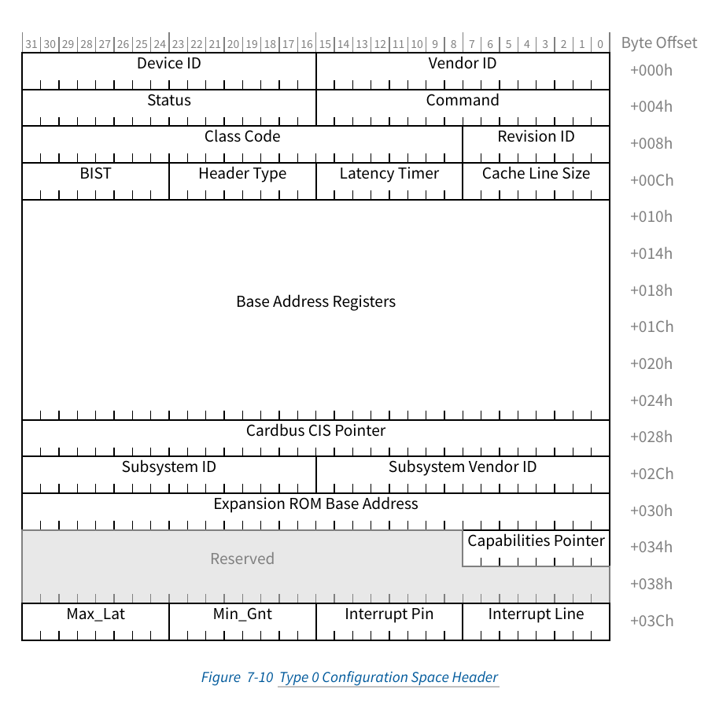

# Configuration Space、ECAM 与配置请求路由

## 1. 它解决什么问题

系统刚上电时，Endpoint 的业务 BAR 地址还没分配，驱动也没加载。操作系统却必须先回答：

- 哪些 Function 存在？
- 它们是谁、是什么设备？
- 需要多大的地址窗口？
- 支持 MSI-X、AER、PCIe speed 等哪些能力？
- 桥后面还有哪些 Bus？

**Configuration Space** 就是这套“先认识、再分房、最后开工”的标准控制面。每个 Function 都有独立 Configuration Space；PCIe 扩展到每 Function 4 KiB，其中前 256 B 保持 PCI-compatible，后 3840 B 是 PCIe Extended Configuration Space。

来源：Base Spec 5.0 §§7.1–7.2，printed/PDF pp.673–676。

## 2. Configuration Space 不是 BAR 空间

Configuration Space 用于标准化发现、资源和能力管理。设备运行期的业务寄存器通常应该放在 BAR 所声明的 Memory Space 中。Base Spec §7.2.2.2 甚至明确建议，driver 运行期访问的 device-specific registers 应放进 BAR 分配的 Memory Space，而不是随意塞进 Configuration Space。

这也是两个 API 家族存在的原因：

- 配置访问：`pci_read_config_*()` / `pci_write_config_*()`；
- 业务 MMIO：`pci_iomap()` 后配合 `readl()` / `writel()`。

它们最终生成的 PCIe transaction 也不同：前者是 Configuration Request，后者是 Memory Request。

## 3. Type 0 与 Type 1 Header

### 3.1 Type 0：Endpoint 和普通 Function 的配置头



> 图源：Base Spec 5.0 Figure 7-10，printed/PDF p.696。

Type 0 header 的前 64 B 包含：

- Vendor ID / Device ID：基本身份与 driver match 的核心输入；
- Command / Status：Memory Space Enable、Bus Master Enable 等控制/状态；
- Class Code / Revision ID：设备类别与版本；
- Header Type：说明头类型及是否 multifunction；
- BAR0–BAR5：最多六个 DWORD 位置；64-bit BAR 会吃掉连续两个位置；
- Subsystem Vendor/Device ID；
- Capabilities Pointer；
- Expansion ROM 与 legacy interrupt 字段。

Type 0 不是“整整 4 KiB 的格式”，而是前 64 B 的标准头布局。后续 0x40–0xFF 可放 PCI-compatible Capability 链；0x100–0xFFF 放 Extended Capability 链。

### 3.2 Type 1：桥/Root Port/Switch Port 的路由控制面

Type 1 header 用于代表 Root Port 和 Switch Port 的 PCI-to-PCI Bridge 结构。它只有两个 BAR DWORD 位置，却多出：

- Primary Bus Number；
- Secondary Bus Number；
- Subordinate Bus Number；
- I/O、Memory、Prefetchable Memory 的 Base/Limit window；
- Bridge Control。

这些字段不是摆设。桥用 Bus Number 决定 ID-routed Configuration Request 往哪边走，用 Base/Limit window 决定 address-routed Memory/I/O Request 是否向下游转发。

Base Spec §7.5.1.3.3–3.4 明确规定 Secondary 和 Subordinate Bus Number 由 configuration software 编程，并用于决定何时转发 ID-routed TLP。来源：printed/PDF pp.704–705。

## 4. ECAM：把 BDF 和寄存器号编码进 MMIO 地址

### 4.1 初学者直觉

ECAM（Enhanced Configuration Access Mechanism）给配置空间铺了一块规整的 CPU MMIO 窗口。访问地址的不同 bit 直接选择 Bus、Device、Function 和 register offset。

对非 ARI Function，Base Spec Table 7-1 定义：

```text
ECAM address = ECAM base
             + (bus      << 20)
             + (device   << 15)
             + (function << 12)
             + register_offset
```

对应 bit：

| CPU memory address bits | 配置目标 |
|---|---|
| A[20+n-1:20] | Bus Number，1 ≤ n ≤ 8 |
| A[19:15] | Device Number |
| A[14:12] | Function Number |
| A[11:8] | Extended Register Number |
| A[7:2] | Register Number |
| A[1:0] + access size | Byte Enables |

因此每个 Function 占 4 KiB，每个 Device 占 32 KiB，每个 Bus 占 1 MiB。一个覆盖 256 个 Bus 的完整 segment 需要 256 MiB ECAM window。

### 4.2 例子

假设 ECAM base 为 `0xE000_0000`，访问 `01:00.0` 的 Vendor/Device ID（offset `0x0`）：

```text
0xE000_0000 + (1 << 20) = 0xE010_0000
```

CPU 对 `0xE010_0000` 的 32-bit read 被 Host Bridge 识别为配置访问，转换成目标 `01:00.0`、register 0 的 Configuration Read Request。它不是发往某个 EP BAR 的 Memory Read。

### 4.3 Memory-mapped 外表，Non-Posted 内核

ECAM 最阴险也最值得理解的一点：CPU 发起的是 memory-mapped access，但 Host Bridge 将它转换成 PCIe Configuration Request。Configuration Write 在线路上是 Non-Posted，需要 Completion。

Base Spec p.678 专门提醒 ordering：CPU/Host Bridge 必须提供办法，保证软件能知道 ECAM write 已由 Completer 完成，避免后续 BAR memory read 越过尚未完成的 BAR 配置写。这说明“同样长得像 MMIO”并不等于“在线路上都是 Memory TLP”。

## 5. Configuration TLP 怎样穿过树

只有 Host Bridge 发起 Configuration Request；规范不支持从下游向上游或 peer-to-peer 发配置请求。

### 5.1 Type 1 Request：还在找目标 Bus

当目标在更深的 Bus，Root Port/Switch Port 根据 Secondary/Subordinate Bus range 检查 Type 1 Configuration Request：

- 目标 Bus 正好是某 Downstream Port 的 Secondary Bus：把 Type 1 转成 Type 0，再发到该 Link。
- 目标 Bus 落在某端口 subordinate range 内但不等于 Secondary Bus：保持 Type 1，继续向下转发。
- 不属于任何下游 range：按 Unsupported Request 处理。

### 5.2 Type 0 Request：目标就在这条 Link 上

Type 0 表示请求已经到达目标所在逻辑 Bus。Endpoint 检查 Function/register 是否实现：

- 有效本地 Function：处理并返回 Completion。
- 无效 Function：返回 Unsupported Request。
- Function 存在但 register 未实现：不是错误；读应以 Successful Completion 返回全 0，写被丢弃。

来源：Base Spec §7.3.3，printed/PDF pp.681–682。

## 6. 一个 Endpoint 从 Link Up 到被发现

先给出协议级骨架，Linux 具体调用链待内核源码补齐：

```text
LTSSM 到 L0
 → firmware/OS 获得 host bridge / ECAM 信息
 → 从 root bus 探测可能的 BDF
 → Configuration Read Vendor ID
 → Completion 返回有效 ID：Function 存在
 → 读取 Header Type / Class / BAR / Capability
 → 若为 bridge：暂时/正式分配 Secondary/Subordinate Bus，递归扫描
 → sizing BAR，规划 resource 与 bridge windows
 → 写 BAR / bridge Base-Limit / Command bits
 → 创建软件设备对象并进行 driver match
 → driver probe
```

这里的“探测 BDF”不等于对 256×32×8 个组合无脑暴力读取；multifunction、桥拓扑、ARI 等规则会缩小/改变扫描方式。精确 Linux 算法需要目标源码确认。

## 7. Capability：把可选能力做成可遍历结构

PCI-compatible Capability 位于前 256 B 中，由 Capabilities Pointer 串成链，常见 PM、MSI、MSI-X、PCI Express Capability。

Extended Capability 从 0x100 起，每项有 Extended Capability Header 和 next pointer，常见 AER、ACS、ATS、SR-IOV、Resizable BAR、L1 PM Substates 等。Base Spec 5.0 §§7.5.3、7.6–7.9 是主要索引入口。

驱动不能假定某能力固定在某 offset；应通过 OS API 遍历 capability。Cadence 特定配置可能给某些能力固定实现位置，但那是实现事实，不会把标准遍历规则取消。

## 8. Linux 视角与 X6000 配置访问路径

Linux driver 应使用 PCI core API 访问配置空间，不应直接手算 ECAM：

```c
u16 cmd;
pci_read_config_word(pdev, PCI_COMMAND, &cmd);
```

概念链路：

```text
pci_read_config_word()
 → pci_bus config ops
 → host-controller / ECAM accessor
 → CPU load or controller command
 → Configuration Read TLP
 → Completion with Data
```

现已补入X6000 Linux 5.10.4：其A8固定C2C拓扑可在
`code_studies/atf_x6000_pcie_stage.md`看到裸机Type 0 config实例，Linux RC路径则在
`code_studies/linux_x6000_pcie_stack.md`追到`pci_ops`和Cadence config outbound。
上述对象链已由目标源码验证；其他架构/内核版本的accessor细节仍不能照搬。

## 9. Debug

- **Link Up，Vendor ID 却全 1：** 检查 config window/ECAM base、Bus Number，确认 Host controller 处于 RC/Host 模式且对应 Core 表现为 Root Port，再检查 Type 0/1 routing、EP Configuration Ready、Completion Timeout/UR。
- **Bus 0 设备可见，桥后设备不可见：** 优先查 Secondary/Subordinate Bus Number 和 bridge routing，而不是先怀疑 EP BAR。
- **前 256 B 可读，扩展空间失败：** 查 ECAM/extended register address 支持；PCI-compatible CAM 不能覆盖完整 4 KiB。
- **写 BAR 后立即访问异常：** 检查 ECAM write completion/ordering 保证和 bridge/resource programming 顺序。

## 10. Source Reference

- PCIe Base Specification 5.0 r1.0, Chapter 7 opening and §§7.1–7.4, printed/PDF pp.673–684。
- PCIe Base Specification 5.0 r1.0, §7.5.1.2 and Figure 7-10, pp.695–700。
- PCIe Base Specification 5.0 r1.0, §7.5.1.3 and Figure 7-14, pp.703–708。
- Cadence PCIe Core User Guide, §§4.5.6, 4.5.6.6.2–.3, printed pp.248, 257–260 / PDF pp.337, 346–349，作为配置请求生成的实现入口。
