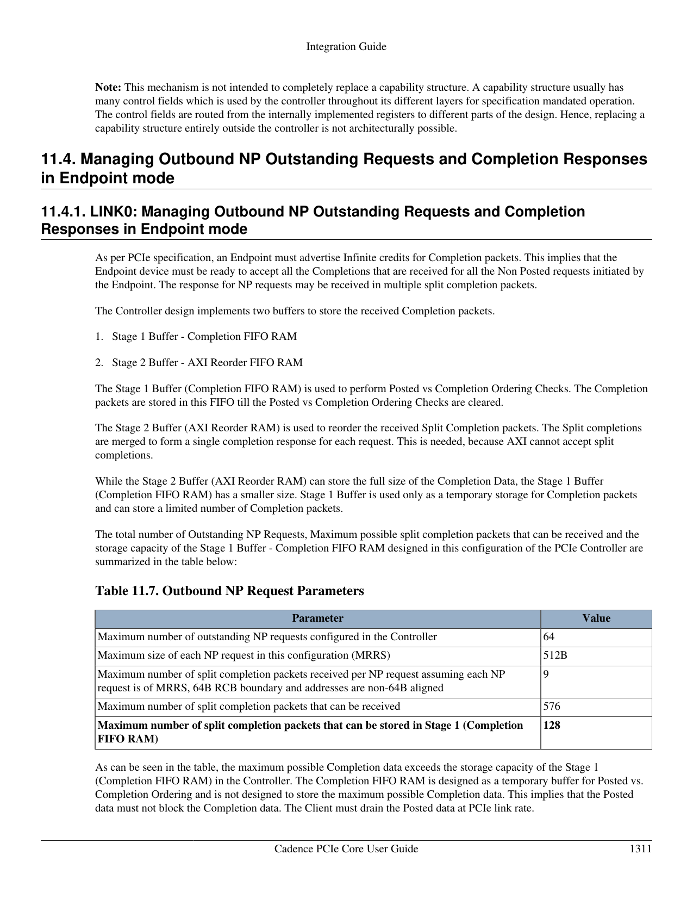

# Cadence Completion Buffer：为什么 64 个合法 Read 也可能把内部 FIFO 顶满

## 1. 问题从哪里冒出来

Endpoint 发出 PCIe Memory Read 后，数据不会沿原请求“原路同步返回”。它稍后收到一个或多个 Completion with Data（CplD），再按 Requester ID、Tag、地址和 Byte Count 把碎片拼回原事务。

这在协议层很自然，在 AXI 一侧却有点别扭：一个 AXI read burst 期待按 AXI 规则返回的数据，而 PCIe 可以把它拆成多个 CplD，甚至与其他 Tag 的 Completion 交错返回。Cadence core 因而要在中间保存、检查顺序并重组数据。

真正危险的是：**“最多 64 个 outstanding”不等于“内部任意一个 buffer 都能装下这 64 笔请求最坏情况下的全部 Completion”。**



> 来源：Cadence PCIe Core User Guide §11.4.1，printed p.1311 / PDF p.1400。截图保留两级 buffer 的原始描述和 Table 11.7；下面把它翻译成可用于设计与调试的因果链。

## 2. 两级 buffer 各做什么

Cadence 为 EP outbound Non-Posted Read 的返回路径安排了两级存储：

```text
Link 收到 CplD
  → Stage 1: Completion FIFO RAM
       暂存并执行 Posted vs Completion ordering checks
  → Stage 2: AXI Slave Read Reorder RAM
       按 Tag/原请求重排 split CplD，合并成 AXI read response
  → local AXI requester
```

Stage 1 不是为“把所有 outstanding read 的所有数据完整屯下来”设计的。它更像入口候车区：等待会影响 Posted/Completion passing 的条件解除。Stage 2 才负责容纳并重排完整 Completion data。

手册说“AXI cannot accept split completions”，不能理解成 AXI 总线完全不能分 beat。准确含义是：PCIe 对一笔 MRd 的多个、可交错 CplD 不能不经转换直接当成一笔 AXI response；core 必须恢复 AXI ID/burst 所需的连续、合规响应。

## 3. 用数字看清楚溢出风险

当前配置每个 Link 的关键上限一致：

| 项目 | 值 |
|---|---:|
| 最大 outstanding NP Read | 64 |
| 当前配置最大 MRRS | 512 B |
| 非 64 B 对齐、RCB=64 B 时，每笔最多 split CplD | 9 |
| 64 笔请求理论最多收到的 split CplD | 576 |
| Stage 1 可存的 split CplD | 128 |

为什么一笔 512 B 会出现 9 个而不是 8 个？若起始地址没按 64 B 对齐，这 512 B 会跨越 9 个 64 B Read Completion Boundary 区间。于是最坏情况是：

```text
64 outstanding × 9 CplD/request = 576 CplD
```

而 Stage 1 只能暂存 128 个。这不是 RTL 算错了，因为设计假设 Completion 会持续向 Stage 2/AXI 方向流动，Stage 1 只是临时执行 ordering check。问题发生在 Posted data 长时间堵塞，使 Completion 也因 passing 规则留在 Stage 1 时。

## 4. 为什么规范说 infinite Completion credit，硬件却仍有有限 RAM

Endpoint 的接收端必须为 Completion advertise infinite credit。这不是说芯片里藏着一块无限 SRAM，而是协议要求 Endpoint 不能靠 Completion credit 把对端卡死。

可行性的基础是：Endpoint 自己控制发出了多少 Non-Posted Request。只要它限制 outstanding、保证内部返回路径能持续 drain，就能承诺接受所有对应 Completion。所谓“infinite credit”是协议接口上的承诺；内部工程实现仍靠请求上限、buffer sizing 和 backpressure 设计兑现承诺。

这也说明为什么驱动/固件不能只盯 `Tag` 数量。Tag table 还有空位，并不代表最窄的 Completion 暂存点也安全。

## 5. Cadence 给出的三种防溢出策略

### 5.1 让 Posted 数据按 Link rate 被 drain

最理想的方案是 local client 能持续接收 `pcie_target_AXI` 上的 inbound write data，不让 Posted traffic 阻塞 Completion。

这要求分析的不只是 PCIe core，还包括下游 AXI interconnect、memory controller、QoS、clock ratio 和 application backpressure。Link 是 Gen4 x16，后面的 AXI target 却常年不 ready，再大的 PCIe 招牌也只是门口霓虹灯亮得比较快。

### 5.2 仅在数据流真正独立时关闭 Posted-vs-Completion ordering check

Cadence `Debug Mux Control 2` 的 `Disable Ordering Checks` bit 30 可以解耦两条数据流，使 Posted 堵塞不再阻止 Completion 前进。

这是有前置证明的性能/容错开关，不是“FIFO 满了就置 1”的急救按钮。只有 application 能证明收到的 Posted data 与 Completion data 完全没有生产者/消费者、doorbell/data visibility 等依赖时才可使用。错误关闭 ordering check 可能把可见性 bug 变成低概率、负载相关的幽灵。

### 5.3 限制 outstanding NP Read 数量

最容易软件控制的办法是调低 Local Management `Debug Mux Control 2.Maximum NP Outstanding Request Limit[7:0]`。手册按 MRRS 和 64 B alignment 给出本配置安全建议：

| MRRS | 请求都 64 B 对齐 | 请求可能不对齐 |
|---:|---:|---:|
| 64 B | 64 | 64 |
| 128 B | 64 | 42 |
| 256 B | 32 | 25 |
| 512 B | 16 | 14 |

例如 MRRS=512 B 且地址不保证 64 B 对齐时，不应仍放行 64 笔；表中建议限制为 14。代价是并发读减少，可能降低长距离/高延迟链路的吞吐；收益是 Stage 1 不会在最坏 split 情况下被淹没。

## 6. 与 MPS、MRRS、RCB、Tag 的完整关系

```text
MRRS
  → 一笔 MRd 请求多大
RCB + request alignment + returned payload limit
  → 被拆成多少 CplD
outstanding limit / available Tag
  → 同时有多少笔 MRd 在路上
Posted-vs-Cpl ordering + AXI backpressure
  → CplD 在 Stage 1 停多久
Stage 1 depth
  → 是否 overflow
Stage 2 reorder capacity
  → 是否能按 AXI transaction 重组返回
```

MPS限制带数据 TLP payload，也会影响 Completion payload 大小，但这里手册的显式 worst case 使用 64 B RCB 和非对齐地址得到 9 个 CplD。调 MRRS、对齐 DMA buffer、限制 outstanding 与改善 AXI drain 都是可用旋钮；它们不能互相当同义词。

## 7. Linux/驱动侧怎样影响这条路径

普通 Linux PCI Function driver 通常不会直接看见 Cadence core 的 Stage 1 FIFO；它看到的是设备 DMA/read queue、timeout、AER 或 controller-specific interrupt。真正控制 Cadence LM limit 的代码应属于 Endpoint firmware、EPC/platform driver 或 SoC glue，而不是任意外设 Function driver。

若设备自己的 queue depth 最终对应 PCIe MRd 并发数，驱动仍会间接影响风险：

- ring 中一次提交多少 read descriptor；
- 每个 descriptor 如何按 MRRS 拆请求；
- DMA buffer 是否 64 B 对齐；
- timeout 后是否继续堆新请求；
- Link Down/error recovery 是否先 quiesce outstanding。

workspace 缺目标 Linux/firmware code，因此尚不能指出哪个函数写 `Maximum NP Outstanding Request Limit`。这条映射保持 Unknown，不拿别的平台函数名来填空。

## 8. Debug：Completion FIFO overflow 时怎么找真正堵点

1. 先冻结新 NP Read，记录 outstanding、MRRS、地址 alignment 和 Tag 使用率；
2. 读 Local Error Status，确认是 Completion RX FIFO Overflow，而不是 Unexpected Completion/CTO；
3. 看 Posted inbound AXI channel 是否持续 backpressure；
4. 检查 application 是否把 Posted data 与 Completion response 建立了相互等待；
5. 临时降低 outstanding limit，观察故障阈值是否按表中关系移动；
6. 在确认两条数据流无依赖后，才把 disable-ordering 作为受控实验；
7. 同时检查 Data Link credit，但不要把内部 FIFO overflow 误诊成“对端不给 Completion credit”——EP 对 Completion advertises infinite credit。

典型危险环：

```text
application 不 drain inbound Posted write
  → Stage 1 因 ordering 暂存 CplD
  → Stage 1 满
  → Completion 返回路径失去空间
  → outstanding read 不结束
  → application 等 read 结束才继续 drain
```

这已经不是简单“把 FIFO 加大”的问题，而是跨 PCIe ordering 与 AXI consumer 的资源依赖环。

## 9. Source Reference

- PCI Express Base Specification Revision 5.0 Version 1.0：§§2.2.9、2.3，Completion split/assembly；§2.4，ordering；§2.6、§3.4，Flow Control。
- Cadence PCIe Core User Guide：
  - §4.1，最多跟踪 64 个 master-side Non-Posted transaction；
  - §11.2 Tables 11.3–11.6，四 Link RAM size，printed pp.1292–1293 / PDF pp.1381–1382；
  - §11.4.1–§11.4.4，two-stage Completion buffering、overflow 条件和三类方案，printed pp.1311–1317 / PDF pp.1400–1406；
  - Tables 11.7–11.14，MRRS/alignment 对应的 outstanding limit。

