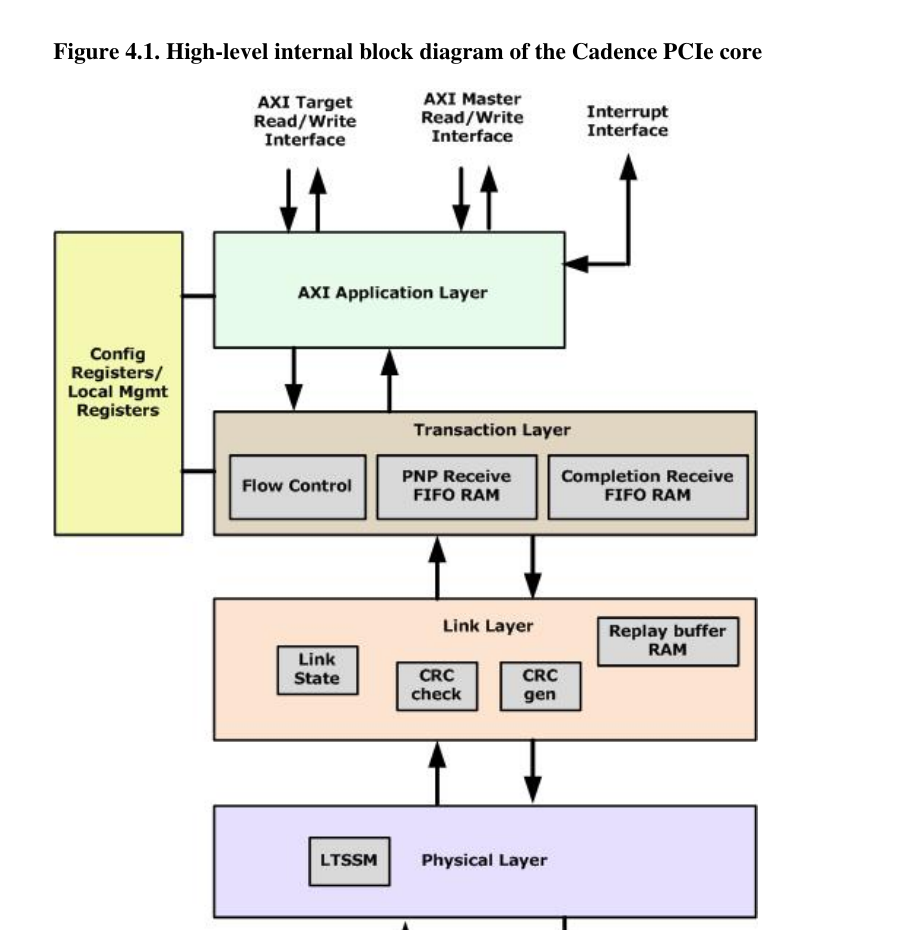

# Cadence PCIe Core：先看清这颗控制器长什么样

## 1. 资料描述的不是“所有 Cadence PCIe”

Cadence guide 明确说它描述的是一个特定配置：**Gen4 x16 Dual-Mode PCIe core**。核心家族可配置成 Endpoint、Root Port，或通过 strap 选择两种模式；支持 PCIe 1.1、2.1、3.0 和 4.0 r1.0。

因此后续看到寄存器或接口时要先问：它是 Cadence 家族通用能力，还是这份生成式手册对应配置的能力？把配置化 IP 手册当成固定芯片手册，很容易拿着一个“理论存在”的寄存器去敲一个实际没综合进去的模块。

**证据：Confirmed。** Cadence §§2.1–2.2，printed pp.6–8 / PDF pp.95–97。

## 2. 当前配置快照

| 项目 | 手册给出的配置 | 工程含义 |
|---|---|---|
| 最大协议代际 | Gen4，16 GT/s | Base Spec 5.0 中的 Gen5 规则不能自动套到此实现 |
| LINK0 | x16 | 可提供最大宽度链路 |
| LINK1 | x8 | 多 Link / 分叉组合的一部分，具体模式待深读 |
| LINK2 | x4 | 同上 |
| LINK3 | x4 | 同上 |
| AXI data path | 256 bit | 应用侧吞吐和对齐的重要边界 |
| AXI address width | 64 bit | 可表达 64-bit 系统地址，但实际有效范围仍取决于 SoC 集成 |
| PIPE per-lane width | 16 bit | controller 与 PHY 的并行数据接口宽度 |
| Functions | legacy Routing-ID 下最多 8；ARI 下最多 256 | 只是核心能力上限，实际配置/模式仍需寄存器章节确认 |

来源：Cadence §2.2，Tables 2.1–2.4，printed pp.6–8 / PDF pp.95–97。

## 3. 内部模块：协议层终于落地了



> 图源：Cadence Figure 4.1，printed p.203 / PDF p.292。

### 3.1 AXI Application Layer

手册把应用侧分成三类接口：

1. **PCIe target-role interface**：接收 Link 进来的访问，交给本地 memory/controller/DMA logic；在 AXI 版本中 core 要作为 **AXI Master** 发本地访问。
2. **PCIe requester/master-role interface**：让本地逻辑主动生成 PCIe request；在 AXI 版本中 client 是 AXI Master、core 暴露 **AXI Slave**。EP 用它做 bus-master DMA，RP 用它生成 Memory、I/O、Configuration 和 Message request。
3. **Interrupt interface**：在用户逻辑和 PCIe core 之间传递中断状态/请求。

这两个 AXI 方向最容易被名字绕晕。用事务角色记更稳：

```text
链路请求打进本地设备         → PCIe target role → core AXI Master interface
本地 client 主动向链路发请求 → PCIe requester role → core AXI Slave interface
```

“inbound/outbound”在不同厂商文档中可能以 RC 或 EP 为观察点，命名未必统一；后续地址翻译文档会坚持画箭头，不靠方位词猜方向。

### 3.2 Transaction Layer

RX TLP 先进入 Receive FIFO，Cadence 手册称完整 packet 存入 FIFO 后才开始 forwarding。解码逻辑再把它送到 host interface 或内部模块。

Receive path 分出：

- PNP（Posted/Non-Posted）Receive FIFO RAM；
- Completion Receive FIFO RAM。

TX path 接受 PNP 与 Completion 两类独立接口，经调度后汇聚到 Data Link Layer。Master side 最多维护 64 个 Non-Posted transactions，保存足够状态以匹配 Completion。

这里已经出现后续寄存器研究的关键问题：FIFO 深度/credit 如何配置？64 outstanding 是否按 Link/Function/traffic type 分配？Tag 位宽和超时如何关联？目前先标为 **Open**，不能从框图脑补。

### 3.3 Data Link Layer

RX：检查 LCRC，去掉 LCRC 后把 TLP 交给 Transaction Layer。

TX：给 TLP 加 LCRC，在 TLP 与 ACK/Flow Control DLLP 之间复用，再送 Physical Layer。Replay Buffer 保留未获确认的 TLP，用于 Link-local retransmission。

这与 Base Spec Data Link 服务直接对应，是后续“寄存器字段为什么存在”的主线：replay timeout、sequence number、ACK/NAK、LCRC error 都不是零散状态位，而是一套可靠传输状态机的外露观察点。

### 3.4 Physical Layer 与 PIPE

RX side 对每条 Lane 独立 descramble，再用 FIFO/de-skew 对齐多 Lane，去除 framing 后交给 Data Link Layer。每条 Lane 的 training receive state machine 解析 training sequence，并把信息交给统一 LTSSM。

TX side 把 Data Link 数据 framing、分布到 Lane，并与 LTSSM 产生的 training sequence 复用；每 Lane 独立 scramble，最终经 16-bit-per-lane PIPE 输出到 PHY。

Controller 负责协议物理层逻辑，外部 PHY 负责电气/SerDes 的具体边界仍需 PHY Databook。没有 PHY 文档时，不能把 PIPE 状态直接等同于引脚上的模拟现象。

## 4. 软件动作与硬件模块的初步对应

| 软件/系统动作 | Cadence 主要落点 | 最终协议行为 | 当前证据 |
|---|---|---|---|
| CPU 通过 BAR 写 EP | EP inbound AXI Master + Transaction RX | 接收 Memory Write TLP，BAR/region decode 后 core 发 AXI write | Confirmed；§§4.5.2、4.5.5 |
| EP DMA 读 Host | EP outbound AXI Slave + Transaction TX/outstanding table | client 发 AXI read，core 转 MRd 并匹配 CplD | Confirmed；§§4.5.6、5 |
| RP 发配置读 | RP outbound AXI Slave / config generation path | client aperture access转 Configuration Read，接收 Completion | Confirmed at controller level；目标 host glue 未提供 |
| Link 数据重传 | Link Layer replay buffer | NAK/replay 或 replay timeout | Confirmed at block level；字段/时序待确认 |
| Link training | Physical Layer LTSSM + PIPE | Detect/Polling/Configuration/Recovery 等 | Confirmed at block level；控制寄存器待确认 |
| 中断 | Interrupt Interface + message/config logic | INTx Message 或 MSI/MSI-X Memory Write | Inferred；模式与 register path 待深读 |

## 5. 后续寄存器阅读顺序

不能从 900 多页 Register Specification 第一行一路抄到最后一行。更有效的顺序是：

1. 先建立配置空间、本地管理空间和 APB 访问地图。
2. 重建 clock/reset/static strap → PHY → controller → link training 的启动序列。
3. 再研究 inbound AXI Master / outbound AXI Slave region 与地址翻译。
4. 用 Memory Write、Memory Read/CplD、Config Read/CplD 三条真实路径串寄存器。
5. 加入 MSI/MSI-X、DMA、error、power 与 recovery。
6. 最后按寄存器覆盖审计补漏，而不是把寄存器表重新排版一遍。

每个访问都要记录 mask/value、前置状态、reset dependency、W1C/self-clearing/reserved-bit 规则以及误配现象。

## 6. Source Reference

- Cadence PCIe Core User Guide, §§2.1–2.2, printed pp.6–8 / PDF pp.95–97。
- Cadence PCIe Core User Guide, §4.1, Figure 4.1, printed pp.202–204 / PDF pp.291–293。
- Cadence PCIe Core User Guide, §4.2 opening, Figures 4.2–4.3, printed pp.204–206 / PDF pp.293–295。
- PCIe Base Specification 5.0 r1.0, §1.5, printed/PDF pp.97–102，用于协议层职责交叉验证。
