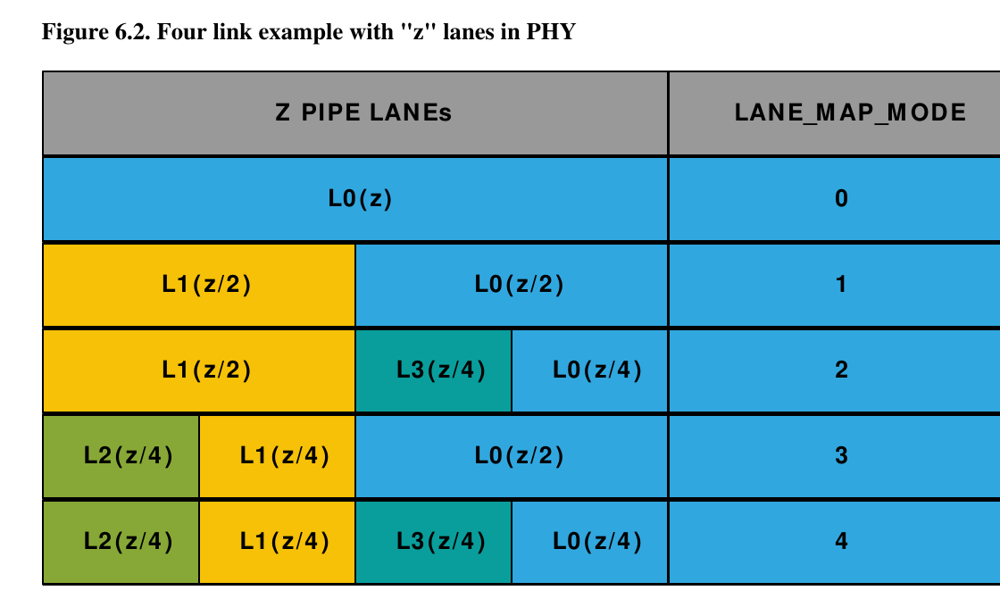

# Cadence 多链路与 Multifurcation：一组 Lane，怎么切成几条 Link

## 1. 它解决什么问题

假设芯片一共引出了 16 条 PCIe Lane。它们既可以合成一条 x16 Link，也可能被切成两条 x8，甚至 x8+x4+x4 或四条 x4。这个动作通常叫 **bifurcation**（二分）或更一般的 **multifurcation**（多分叉）。

直觉上，它像把一条 16 车道的超宽公路重新画线。关键是：画完以后得到的不是“一条公路里的四个逻辑队列”，而是若干条可以独立训练、独立枚举、独立掉线的 PCIe Link。

## 2. 先解开手册里看似矛盾的两句话

Cadence §2.2 同时列出：

| 逻辑实例 | 该实例的最大配置宽度 |
|---|---:|
| LINK0 | x16 |
| LINK1 | x8 |
| LINK2 | x4 |
| LINK3 | x4 |

这不等于芯片同时拥有 `16+8+4+4=32` 条物理 Lane。这里描述的是四个逻辑 core 实例各自能够承接的最大宽度；真正同时连接哪些实例、每个实例拿到哪几条 PHY Lane，由静态输入 `LANE_MAP_MODE` 决定。

对本手册的 16-Lane、四 Link 配置，信号说明给出了精确模式：

| `LANE_MAP_MODE` | 实际 Lane 分配（Lane 编号从 0 开始） | 同时活动的 Link |
|---:|---|---|
| 0 | LINK0 = Lane 0–15，x16 | LINK0 |
| 1 | LINK0 = Lane 0–7，x8；LINK1 = Lane 8–15，x8 | LINK0、LINK1 |
| 2 | LINK0 = Lane 0–3，x4；LINK3 = Lane 4–7，x4；LINK1 = Lane 8–15，x8 | LINK0、LINK3、LINK1 |
| 3 | LINK0 = Lane 0–7，x8；LINK1 = Lane 8–11，x4；LINK2 = Lane 12–15，x4 | LINK0、LINK1、LINK2 |
| 4 | LINK0 = Lane 0–3，x4；LINK3 = Lane 4–7，x4；LINK1 = Lane 8–11，x4；LINK2 = Lane 12–15，x4 | 四条 Link |



> 图源：Cadence Figure 6.2，printed p.300 / PDF p.389。图中横向位置代表 PHY Lane 分组；不要把 L0/L1 误看成 LTSSM 的电源状态，它们在这里是 LINK0/LINK1 的缩写。PCIe 的缩写偶尔会自己撞车，文档作者也拦不住。

**结论：Confirmed。** 先前“x16/x8/x4/x4 是否能同时存在”的问题已经解决：它们是 wrapper 中四个独立逻辑 core 的能力上限，模式 0–4 再把 16 条物理 Lane 分给其中一个或多个实例。

## 3. 硬件内部到底复制了什么

Cadence §4.9 对双 Link 版本的描述最直接：`bifurcated_top` wrapper 内含两个 `databahn_top` core 实例。单 Link 模式把全部 Lane 给 LINK0，LINK1 不活动；双 Link 模式把上下两半分别给 LINK0 和 LINK1。两个 core 可以独立选择 generation、Lane 数以及 RP/EP 模式。

Chapter 6 把同一思路推广到多个 Link：

```text
一组 PHY / PIPE Lane
        │
        ├── PIPE mux/demux + LANE_MAP_MODE（静态）
        │
        ├── LINK0 PCIe core ── LINK0_* client/APB/status
        ├── LINK1 PCIe core ── LINK1_* client/APB/status
        ├── LINK2 PCIe core ── LINK2_* client/APB/status
        └── LINK3 PCIe core ── LINK3_* client/APB/status
```

每个 Lane group 可有自己的 `PIPE_PCLK`，client 接口用 `LINK{N}_` 前缀区分。Cadence 还提醒，每增加一个 Link，大致会增加一个对应宽度 core 的门数；multifurcation 会带来实际的硬件资源开销，而不仅是接口命名上的变化。

## 4. 它和 PCIe hierarchy 有什么关系

每条活动 Link 都是独立的 point-to-point Link，各有自己的：

- Physical Layer 与 LTSSM；
- Data Link sequence/replay/credit 状态；
- Transaction Layer 队列；
- 配置/本地管理/AXI/DMA 寄存器组；
- mode、speed、width、reset、interrupt 和错误状态。

在 RP 模式下，一条活动 Link 通常表现为一个独立 Root Port 的下游分支；Linux 会为每个可枚举的 Root Port 建立对应的 `pci_bus` 层次。某条 Link 没有设备或训练失败，不应天然拖死另三条 Link——实际中断汇聚和 reset dependency 仍取决于 SoC wrapper，当前资料没有给出这部分。

在 EP 模式下，多条 Link 是否被系统产品真正允许同时作为多个独立 Endpoint 端口，还要看板级拓扑、PHY、reset/refclk 和 SoC 集成，不能仅凭 IP core 能力宣布产品支持。

## 5. 为什么 `LANE_MAP_MODE` 必须在训练前确定

手册把它定义成 **Static strap input**。这是合理的：LTSSM 在 Detect/Polling/Configuration 阶段会协商 Lane 编号、Link width、Lane reversal 等；训练途中突然把 Lane 从 LINK0 搬给 LINK3，相当于高速公路开着车时重新画隔离墩。

因此典型启动依赖是：

```text
板级/strap 确定 LANE_MAP_MODE
  → PHY 采用匹配的 Lane/clock 分组
  → 各活动 core 的 mode/speed/equalization 参数就绪
  → 释放对应 reset
  → 分别使能 LINK_TRAINING_ENABLE
  → 每条 Link 独立进入 LTSSM
```

Cadence 明确要求集成 PHY 也支持 bifurcation。controller 设置正确、PHY 仍把 16 Lane 当作同一 clock group，Link 一样起不来；锅不能只让 LTSSM 背。

## 6. 软件初始化和 Debug 要按 Link 做

固件或 host-controller driver 至少需要按活动 Link 实例维护：

1. strap/mode 的只读确认；
2. 对应 `LINK{N}_` clock、reset、PHY 与训练使能；
3. RP/EP Configuration Register Set；
4. Local Management status/mask；
5. AXI address regions；
6. 如启用则配置独立 uDMA；
7. Link up 后读取实际 negotiated speed/width。

建议打印下面这种启动摘要，而不是只打印一句 `link up`：

```text
lane-map=3
LINK0: enabled, RP, lanes[7:0], expected x8, negotiated Gen4 x8
LINK1: enabled, RP, lanes[11:8], expected x4, negotiated Gen4 x4
LINK2: enabled, RP, lanes[15:12], expected x4, negotiated Gen3 x4
LINK3: inactive
```

如果 LINK2 只到 Gen3，它至少告诉我们“拓扑和 Lane 分配大概率成立，速率训练另有问题”；这比四句一模一样的 `PCIe link status = 1` 有用得多。

## 7. 常见误解

### “四个 Link core 所以有 32 条 Lane”

不对。core 的最大宽度是能力上限，物理资源仍是 16 Lane，模式矩阵决定并发组合。

### “x8+x4+x4 只有一种排列”

不对。本配置的 mode 2 与 mode 3 都是 x8+x4+x4，但 x8 分配给的逻辑实例和 Lane 区间不同。

### “Link width 协商会自动决定 multifurcation”

不对。`LANE_MAP_MODE` 先静态决定哪些 Lane 属于哪条 Link；随后每条 Link 才能在自己分到的最大宽度内完成训练和降宽协商。

### “所有 Link 共享一套 LTSSM”

不对。独立 Link 必须有独立训练与 Link-local 协议状态。wrapper 共享的是物理 Lane 资源和选择逻辑，不是把四条 Link 塞进一个 LTSSM。

## 8. 证据边界

- **Confirmed**：本手册实例的五种 Lane map、四个逻辑 core、每 Link 接口前缀、独立 core 结构。
- **Confirmed**：Cadence 家族概念上最多支持 16 Lane、16 个独立 Link，但这是可配置 IP 的家族上限，不代表本实例综合了 16 个 Link。
- **Unknown**：目标 SoC 是否把所有五种 mode 引到产品 strap、每种 mode 的 refclk/reset/IRQ/MSI wiring、Linux 中每条 Link 的 platform device 表达。需要 SoC TRM、DTS 和 driver。

## 9. Source Reference

- Cadence PCIe Core User Guide, §2.2, Tables 2.1–2.4, printed pp.6–8 / PDF pp.95–97。
- Cadence PCIe Core User Guide, `LANE_MAP_MODE` signal description, printed pp.123–124 / PDF pp.212–213。
- Cadence PCIe Core User Guide, §4.9, Figure 4.24, printed pp.279–280 / PDF pp.368–369。
- Cadence PCIe Core User Guide, Chapter 6, Figures 6.1–6.4, printed pp.299–301 / PDF pp.388–390。
