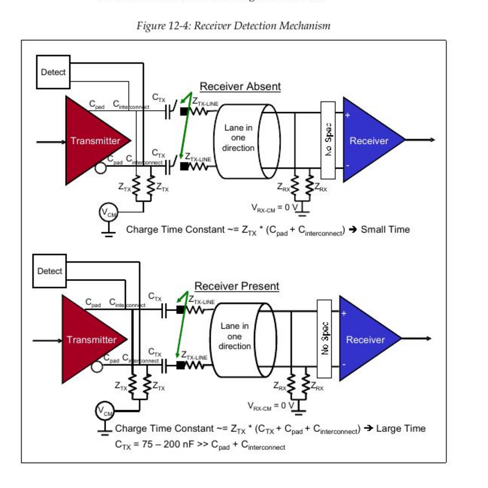

# Link Not Up：按 LTSSM 停在哪一站查，不要靠玄学换线

## 1. 先定义“没起来”是哪一种没起来

依次确认：

1. LTSSM 是否离开 Detect；
2. 是否到 Physical L0；
3. Data Link 是否 DL_Up；
4. Config Read Vendor ID 是否成功；
5. OS 是否枚举出 BDF；
6. negotiated speed/width 是否达到预期。

“`lspci` 没看到设备”只能说明第 5 步失败，不能直接证明 PHY 没 Link Up。

## 2. 通用前置检查

- power rails、PERST# 时序、refclk/SSC 架构是否符合 board/PHY 要求；
- RP 和 EP mode 是否配反；两端都是 RP 或都是 EP 时 Configuration 无法完成；
- PIPE/core/AXI/APB/PM clocks 是否存在且频率正确；
- reset 是否在各 clock domain 同步释放；
- PHY APB 初始化、PLL lock/clock stable 是否完成；
- Cadence static straps 是否在 MGMT reset 释放前稳定；
- `LINK_TRAINING_ENABLE` 是否为 1；
- lane count strap 与真实布线、PHY active lanes 是否一致。

## 3. 按 Cadence LTSSM_STATE 分诊

### `0x00 Detect.Quiet`

- 可能是 firmware 有意保持 training enable=0 配 Local Management；
- 检查 reset_N、PIPE reset、training enable；
- 初始停留可达规范 timer，仿真别过早 timeout；
- 确认 PHY refclk/PLL/clock stable。

### `0x01 Detect.Active`

Detect 还没有开始交换 TS1。发送端先改变 Lane 的共模条件，利用 AC 耦合电容和远端 receiver termination 造成的充电时间差，判断“线的另一头有没有接收器”。远端存在时，耦合电容与终端进入等效 RC 路径，响应与开路时不同；具体动作由 PHY 完成，Controller 只通过 PIPE 发起并接收结果。

> 图源：MindShare *PCI Express System Architecture*，Figure 12-4，printed p.460 / PDF p.516。此图用于解释检测直觉；其中早期电气参数不能替代 PCIe 5.0、CEM 或目标 PHY Databook 的限值。

- Controller 应拉起 `PIPE_TX_DETECT_RX`；
- PHY 应在每条配置 Lane 给 `PIPE_PHY_STATUS` pulse；
- 同拍 `PIPE_RX_STATUS=011` 表示检测到 receiver；
- `LANE_COUNT_IN` 要与等待响应的 Lane 集合一致。

若某几 Lane 检测失败，查 termination、lane mapping、AC coupling、power、connector；若仍能成较窄 Link，则记录 downtrain，而非简单写“link ok”。

### `0x02 Polling.Active`

- 查 TX/RX TS1；Gen1 TS1 未 scrambling，PIPE 上较容易辨认；
- 查 bit/symbol lock、polarity、RX electrical idle；
- Cadence 等 8 个连续无错 TS1；误码会让“明明有波形”仍无法前进。

### `0x04 Polling.Configuration`

- 查双方 TS2；Cadence 等 8 个连续无错 TS2；
- 检查 training sequence 字段和 PHY decode，不要拿 TLP decoder 看 TS2。

### `0x05 Configuration.Linkwidth.Start`

- 确认一端 RP、一端 EP；同角色配对会卡住；
- RP 应发 Link Number 0、Lane Number PAD；EP 应采纳收到的非 PAD Link Number；
- 检查连续 TS1 的 Link/Lane number。

### `0x06–0x08 width/lane negotiation`

- Lane number 是否连续、稳定、同 Link Number；
- lane reversal 是否被正确识别；
- 是否只有某个 contiguous subset 能工作；
- board lane swizzle 是否在 controller/PHY 支持范围内。

### `0x09/0x0A Complete/Idle`

- Complete 查连续匹配的 TS2；
- Idle 查至少 8 个连续 Idle symbols；
- 若来回退转，保存 16-entry LTSSM history 查看真正的退回条件。

### `0x0B–0x0E / 0x28–0x2B Recovery/Equalization`

- 初次升速短暂出现正常；持续循环异常；
- 限到 Gen1/降低 width 做 A/B，若稳定则重点查高频 SI、preset/coefficient、channel loss、refclk/SSC；
- 查 per-lane equalization status、receiver lock、framing error、Lane Error Status。

## 4. LTSSM=L0 但仍枚举失败

继续查 Data Link：

- DL Feature Exchange 是否卡住；
- InitFC1/InitFC2 是否互收，VC0 credits 是否初始化；
- DLL CRC/Flow Control Protocol Error；
- Cadence `CONFIG_ENABLE` 是否仍为 0，导致 EP 对 Config Request 返回 CRS；
- RP ECAM/outbound config window、bus number 和 Type 0/1 routing；
- Config Read Request 是否发出，EP 是否返回 CplD/CRS/UR。

## 5. 必留证据

- current + 至少 16 次 LTSSM transition；
- negotiated/detected lane bitmap、speed/width；
- reset/refclk/clock-stable/training-enable 时间关系；
- PIPE receiver-detect response；
- TS1/TS2 fields 或 protocol analyzer trace；
- DL state、InitFC credits；
- AER/receiver/framing/equalization status；
- Linux `dmesg` 与 Root Port `lspci -vv`（若配置空间可达）。

## 6. Source Reference

- PCIe Base Specification 5.0 r1.0, §§3.2–3.4、4.2.5–4.2.6。
- MindShare *PCI Express System Architecture*, Chapter 12, Figure 12-4, printed p.460 / PDF p.516（receiver-detect直觉；数值以现代规范/PHY为准）。
- Cadence PCIe Core User Guide, Appendix G.1, printed pp.1362–1368 / PDF pp.1451–1457。
- Cadence PCIe Core User Guide, §11.1.2、§11.7.2.2、Appendix A/C。
