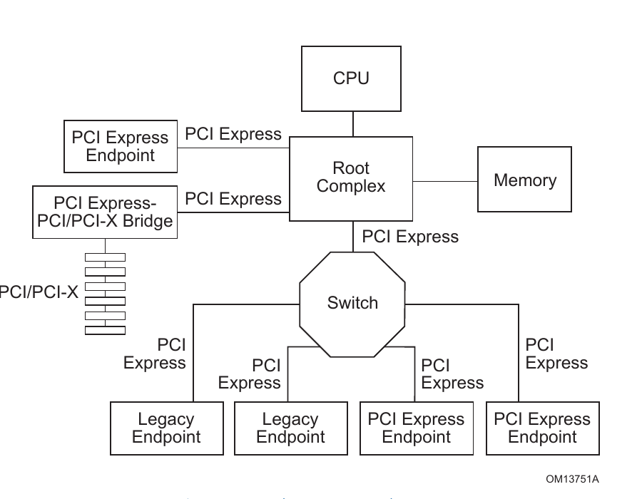

# PCIe 世界观：拓扑、角色与三层协议

## 1. 先说结论

PCI Express 是一种面向高性能 I/O 的、点到点、全双工、分组化互连。它在线路和协议上更像一张小型网络，却刻意保留了 PCI 的软件模型：操作系统仍通过 Configuration Space 发现设备、用 BAR 分配地址，再以 load/store 语义访问设备。

这句话里藏着 PCIe 最重要的设计取舍：

- 对硬件来说，它把共享并行总线换成高速串行 Link、Switch 和 packet protocol。
- 对软件来说，它尽量让旧 PCI 的枚举、配置和驱动模型继续工作。

所以 PCIe 既“革命”又“保守”。这不是人格分裂，是兼容性工程。

**证据：Confirmed。** Base Spec 5.0 §1 与 §1.1 明确说明 PCIe 保留 PCI 的 usage model、load-store architecture 和 software interfaces，同时把 parallel bus 替换为 scalable serial interface，并要求 PCI-compatible software model。来源：`PCI_Express_Base_Specification_Revision5.0r1.0.pdf`，printed/PDF pp.89–90。

## 2. 为什么它比 I2C / SPI 复杂这么多

先从熟悉的外设总线出发。

I2C/SPI 的典型问题是：“CPU 怎样给一个已知外设发几字节命令？”设备数量不多，拓扑通常固定，地址/片选由板级设计决定，事务大多由 CPU 主动发起。

PCIe 要同时解决另一组更麻烦的问题：

- 设备和 Switch 可能形成多级树，开机前软件不知道拓扑。
- 一个设备可以有多个 Function，每个 Function 都要被独立识别、配置和驱动。
- CPU 要访问 EP，EP 也要主动 DMA Host Memory；双方都可能是 Requester。
- 多个请求可以同时在途，返回顺序不必等于发出顺序，因此要靠 Tag 配对。
- 每条 Link 都要训练、协商速率和 Lane 数，链路还会省电、恢复和重训。
- 高速串行误码需要链路级检测、ACK/NAK 和 Replay，同时还要有端到端错误语义。
- 系统必须分配 MMIO 地址、路由中断、隔离 DMA，并在设备出错时尽量恢复。

如果把 SPI 看成“两个人拿着对讲机按约定说话”，PCIe 更像“有地址规划、路由、信用额度、可靠传输和事故上报的园区网络”。只是这张网络最终仍要让 CPU 感觉自己在读写寄存器。

## 3. Link 与 Lane：x4 表示什么

### 3.1 直觉

**Link** 是两个相邻 PCIe 组件之间的一条逻辑连接。它是 dual-simplex：A→B 和 B→A 各有自己的单向通路，因此两个方向可以同时传输。

**Lane** 是 Link 的最小物理宽度单位，包含：

- 一组发送差分对；
- 一组接收差分对。

多条 Lane 可以聚合成 x2、x4、x8、x16 等 Link。`x4` 表示四条 Lane 并行工作，并不表示单条 Lane 的时钟频率提高到四倍。

### 3.2 规范定义

Base Spec 5.0 §1.2 定义基本 Link 至少有一条 Lane，并列出 x1/x2/x4/x8/x12/x16/x32 宽度；每条 Lane 在每个方向都有一对差分信号。Gen1 到 Gen5 的 signaling rate 分别为 2.5、5.0、8.0、16.0、32.0 GT/s。

这里用 GT/s 而不是随手写成 GB/s，是因为线上传输还包含编码和协议开销。有效 payload 带宽不能只拿 `GT/s × Lane 数` 就收工。

### 3.3 谁建立 Link

链路上电后，两个端口的硬件通过 Link Training 协商 Lane width 和 signaling rate。Base Spec §1.2 明确说这个初始化过程不需要 firmware 或 OS 参与。负责这一过程的硬件状态机叫 **LTSSM**（Link Training and Status State Machine）。

软件可以控制“允许训练”“请求 retrain”“目标速率”等策略，但 TS1/TS2 的具体收发由链路硬件完成，不是 Linux 软件逐周期驱动。

## 4. RC、Root Port、Endpoint 和 Switch



> 图源：PCI Express Base Specification 5.0 r1.0，Figure 1-2，printed/PDF p.92。这里保留原图是因为它把 RC、Switch、EP 与旧 PCI bridge 的关系画得很直接。

### 4.1 Root Complex（RC）

**直觉：** RC 是 Host 世界和 PCIe 世界的总入口。CPU、Host Memory 在一边，PCIe hierarchy 在另一边。

**规范：** Base Spec §1.3.1 把 RC 定义为 I/O hierarchy 的根，连接 CPU/memory subsystem 与 I/O。一个 RC 可以支持一个或多个 PCIe Port，每个接口形成单独的 hierarchy domain。

**硬件行为：** RC 需要把 CPU 侧的配置或 MMIO 访问转换为 PCIe Request，并把 EP 发往 Host Memory 的请求送到内存系统；是否支持跨 hierarchy domain 的 peer-to-peer routing 属于实现相关能力。

**软件视角：** Linux 会为 host bridge 建立 `pci_host_bridge`/root bus（具体结构和调用链需目标内核源码确认），从根总线开始枚举下游设备。

### 4.2 Root Port（RP）

Root Port 是 RC 向一个 hierarchy domain 暴露的 PCIe Port。它在配置模型上是桥型 Function，下游可以直连一个 EP，也可以连接 Switch。

常见误区是把 RC 和 RP 当成同义词。一个 RC 可以包含多个 RP：RP 是 PCIe hierarchy 顶部的一个端口，RC 则还包括 Host 侧连接、地址路由以及相关控制逻辑。芯片框图有时会把整个模块统称为 PCIe RC controller，因此阅读寄存器手册时，需要分清它指的是协议角色还是完整的 IP block。

### 4.3 Endpoint（EP）

**规范：** Base Spec §1.3.2 定义 Endpoint 是一种 Function，能够代表自己或非 PCIe 设备发起/完成 PCIe transaction。

一个 EP 可以扮演两种事务角色：

- **Completer：** Host 对它的 BAR 发 Memory Read，它返回 Completion with Data。
- **Requester：** 它的 DMA engine 向 Host Memory 发 Memory Read/Write。

因此“Endpoint 只能被动挨访问”是错的。没有 bus-master 能力的简单 EP 可以很被动，但高性能网卡、NVMe、GPU 恰恰大量主动发请求。

标准 PCIe Endpoint 使用 Type 0 Configuration Header，必须作为 Completer 支持 Configuration Request。如果设备需要中断资源，标准 Endpoint 需要支持 MSI 或 MSI-X；这些规则见 Base Spec §1.3.2.2，printed/PDF p.94。

### 4.4 Switch

PCIe Link 是点到点的，要连接多个设备就需要 Switch。Switch 根据地址或 ID 路由 TLP；在配置模型里，它由多个虚拟 PCI-to-PCI Bridge 组成：一个 Upstream Port 面向 RC，多个 Downstream Port 面向下游。

这解释了为什么 `lspci -t` 看到的是树，而不是一串共享在同一根线上的设备。Switch 不是“透明电线分叉器”，它有配置空间、桥窗口、Bus Number 和错误/电源管理职责。

## 5. Hierarchy 与 BDF：软件给树上的 Function 发门牌号

一组从 RC 接口向下展开的 Root Port、Switch 和 Endpoint 构成 PCIe hierarchy。软件用 **Bus / Device / Function（BDF）** 标识一个 Function，例如：

```text
00:01.0  Root Port
01:00.0  Endpoint Function 0
```

传统 BDF 编码中：Bus 8 bit、Device 5 bit、Function 3 bit。Bus Number 通常由 firmware/OS 在枚举桥层次时配置，不是焊死在 EP 里的身份证号；设备换个槽位或拓扑，BDF 可能变化。

BDF 后续会同时出现在三个世界：

- 软件对象和用户工具，例如 `0000:01:00.0`；
- Configuration Request 的目标与桥的 ID routing；
- TLP 中的 Requester ID / Completion 中的身份和错误归属。

配置与枚举的完整因果链将在独立文档中展开。

## 6. 三层协议各管哪摊事

PCIe Base Spec §1.5 把协议分成 Transaction、Data Link 和 Physical Layer。别急着背定义，先看一笔“CPU 读 EP 寄存器”的分工。

### 6.1 Transaction Layer：决定这笔业务是什么

CPU 读某个 BAR 地址，RC Transaction Layer 形成 Memory Read Request TLP。TLP 会描述：

- 这是 Memory Read；
- 读哪个地址、多少 DW；
- 谁发的（Requester ID）；
- 用哪个 Tag 区分在途请求；
- Byte Enable、Traffic Class、Attributes 等。

EP 收到后解析请求，命中 BAR，并返回 Completion with Data。Transaction Layer 负责 Request/Completion、routing 和 ordering 等端到端事务语义；它也按 traffic class/type 做 credit accounting，但 credit 是相邻 Port 在**每条 Link 上逐跳**维护的，不是从 EP 一路预订到 Host Memory 的端到端额度。

### 6.2 Data Link Layer：保证这一跳靠谱

TLP 每经过一条 Link，Data Link Layer 会加入 Sequence Number 和 LCRC。接收端校验成功后发 ACK，检测到可重试错误则发 NAK；发送端保留 Replay Buffer，必要时重传。

关键点：这是 **Link-local** 可靠性，不是端到端 Completion。ACK 只说明“相邻接收端正确收到了这个 TLP”，不说明最终业务已经成功。把 ACK 和 Completion 混在一起，是非常高产的一类误解。

### 6.3 Physical Layer：把包变成 Lane 上的信号

Physical Layer 负责 framing、编码/扰码、Lane 分发与对齐、训练序列、LTSSM 和真实电气传输。它把上层数据送进 SerDes/PHY，也从多个 Lane 恢复出有序数据。

Base Spec 的职责概览见 §1.5.1–1.5.4，printed/PDF pp.97–102。

## 7. 一次 Memory Read 的最小故事

假设：

```text
RC / Root Port: 00:01.0
EP:             01:00.0
EP BAR0:        PCI address 0x8000_0000，size 64 KiB
目标寄存器:      BAR0 + 0x100
```

Linux 驱动从 `pci_iomap()` 得到映射后的 `__iomem` 虚拟地址，再调用 `readl(bar0 + 0x100)`。概念路径是：

```text
CPU load
 → 虚拟地址翻译为 CPU physical MMIO address
 → Host bridge / RC outbound window 匹配
 → 形成目标 PCI address = 0x8000_0100 的 Memory Read TLP
 → Data Link 加 Sequence Number/LCRC
 → Physical Layer 在 Link 上发送
 → EP 校验、解析、BAR0 hit
 → EP 内部 AXI/APB 读取寄存器
 → EP 形成 Completion with Data
 → 沿 Link 返回，RC 用 Requester ID + Tag 匹配原请求
 → CPU load 得到数据
```

注意这只是概念路径：CPU physical MMIO 是否等于 PCI address、RC 是否做地址平移，要看 host bridge window 和 SoC 集成。PCIe 最喜欢在“地址”前面藏形容词，后续会专门拆开 CPU、PCI 和 DMA address。

## 8. Cadence Core 如何把三层做成硬件


> 图源：Cadence PCIe Core User Guide，Figure 4.1，printed p.203 / PDF p.292。

这张图把抽象协议变成了可触摸的模块：

- AXI Application Layer 提供 Target、Master 和 Interrupt 接口。
- Transaction Layer 有 Flow Control、PNP Receive FIFO 和 Completion Receive FIFO。
- Link Layer 有 LCRC check/generate、Link State 和 Replay Buffer RAM。
- Physical Layer 有 LTSSM，并通过 PIPE 连接 PHY。
- Configuration Registers / Local Management Registers 横向配置和观测各层。

Cadence 4.1 还说明，master side 可维护最多 64 个 Non-Posted transactions，以便将返回 Completion 与请求匹配。这正是抽象的 `Tag + outstanding request` 在硬件里的落点之一。

## 9. 常见误解速查

- **“Link up 以后设备一定能枚举。”** 不一定。Link 只说明物理/链路基本建立；配置请求路由、Bus Number、配置窗口、复位状态都可能让枚举继续失败。
- **“Data Link ACK 等于一次 Memory Read 成功。”** 不等于。ACK 只确认相邻 Link 收包；Memory Read 的业务结果靠 Completion。
- **“RC 就是一个 Root Port。”** 不等于。RC 可以包含多个 Root Port 和更多 Host 侧功能。
- **“Endpoint 只能响应 Host。”** 不对。支持 bus master 的 EP 会主动 DMA Host Memory。
- **“PCIe 5.0 Spec 意味着当前 Cadence 核心跑 Gen5。”** 不对。当前 Cadence guide 明确描述 Gen4 x16 Dual-Mode 配置；Spec 5.0 是研究标准的版本基线。

更多见 [COMMON_MISCONCEPTIONS.md](../COMMON_MISCONCEPTIONS.md)。

## 10. Debug 入口

遇到问题先按层问：

1. Link 是否进入 L0？若否，查 clock/reset/PHY/LTSSM/training。
2. Link up 但无设备？查 Configuration access、Bus Number、RP/EP mode、配置请求和 Completion/UR。
3. 能枚举但 BAR 访问失败？查 resource、Command.MSE、host outbound window、TLP address、EP BAR decode 和 Cadence inbound AXI Master path。
4. MMIO 正常但 DMA 失败？查 Command.BME、DMA address/IOMMU、MRd/MWr、Completion、cache sync。
5. DMA 完成但没中断？查 MSI/MSI-X capability/table、Memory Write、interrupt remapping 和 Linux vector。

“先分层”听起来朴素，却能避免拿 LTSSM 寄存器解释一个 DMA mapping bug——那通常是一次漫长而无效的跨界执法。

## 11. Source Reference

- PCI Express Base Specification 5.0 r1.0, Chapter 1, especially §§1.1–1.5, printed/PDF pp.89–102。
- Cadence PCIe Core User Guide, §§2.1–2.2, printed pp.6–8 / PDF pp.95–97。
- Cadence PCIe Core User Guide, §4.1 and Figure 4.1, printed pp.202–204 / PDF pp.291–293。
- PCI Express Basics & Background, slides/PDF pp.20–39，作为辅助教学图示；规范结论仍以上述 Base Spec 为准。
