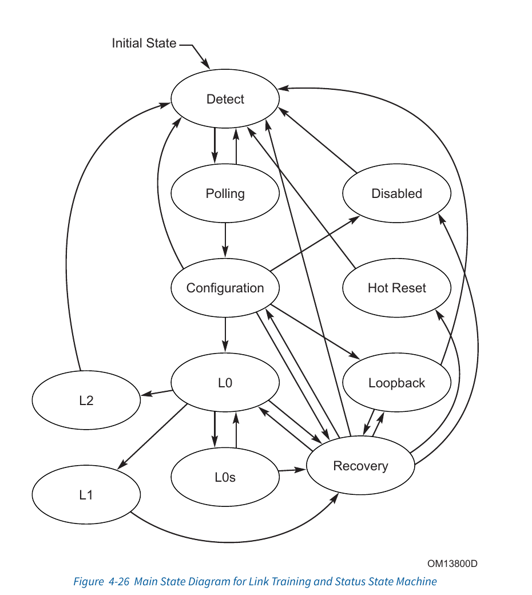

# Link、Lane 与 LTSSM：两端从“你在吗”谈到 Gen4 ×16

## 1. Link 不是“PCIe 总线的一根线”

一条 PCIe **Link** 只连接相邻的两个 Port，是 point-to-point、full-duplex 的通信通道。它可以由 1、2、4、8、16 条 **Lane** 组成；每条 Lane 又有一对 TX 差分线和一对 RX 差分线。

因此 `Gen4 ×8` 同时说了两个维度：

- 每 Lane 的 signaling rate 是 16.0 GT/s；
- 8 条 Lane 聚合成 Link。

`GT/s` 是每秒传输次数，不直接等于应用数据 GB/s。编码开销、TLP/DLLP/header、flow control、replay 和 workload 都会吃掉带宽。Gen1/2 使用 8b/10b，Gen3/4 使用 128b/130b；这就是为什么“16 GT/s × 8 ÷ 8”只能算毛坯房面积，不能当实际可住面积。

## 2. LTSSM 解决什么问题

上电时，两端还不知道：

- 对面是否真的存在、接收端 termination 是否可检测；
- bit/symbol/block 能不能锁住，Lane 极性是否反了；
- 哪些物理 Lane 可用，能组成多宽的 Link；
- 双方共同支持的最高 speed；
- 多 Lane 到达时间差怎样 de-skew；
- 发生误码、速率切换或电源状态变化后怎样恢复。

**LTSSM**（Link Training and Status State Machine）是 Physical Layer 的硬件状态机，用 Ordered Sets 和电气状态完成这些协商。它不是 Linux 线程，也不是固件里一串 `switch-case`。软件可以允许/禁止训练、请求 retrain、读 status；但每个 TS1/TS2 的发送接收由硬件完成。



> 图源：PCIe Base Specification 5.0 r1.0，Figure 4-26，printed/PDF p.317。只裁取状态图用于说明状态之间的关系。

## 3. 第一次建链的主干

```text
Fundamental Reset
 → Detect.Quiet
 → Detect.Active
 → Polling.Active
 → Polling.Configuration
 → Configuration.Linkwidth.Start
 → Configuration.Linkwidth.Accept
 → Configuration.Lanenum.Wait / Accept
 → Configuration.Complete
 → Configuration.Idle
 → L0 at 2.5 GT/s
 → optional Recovery.Speed / Equalization
 → L0 at highest common speed
```

Base Spec 要求 Link 首先以 2.5 GT/s 进入 L0，即便双方都支持更高 speed。更高能力通过 TS1/TS2 广告，之后从 L0 进入 Recovery 完成 rate change；Gen3/Gen4 还涉及 equalization。

### 3.1 Detect：先看看对面有没有终端

`Detect.Quiet` 中 transmitter 为 Electrical Idle，并保证接收 termination 条件和 Gen1 频率准备好。`Detect.Active` 执行 receiver detection；成功的 Lane 才进入 Polling。

这一步还没有“交换设备 ID”，甚至没有正常 packet。若卡住，优先看 power、PERST#/reset、refclk、PHY PLL/PIPE 与接收 termination，不要先怀疑 BAR——BAR 此时还没登场。

### 3.2 Polling：建立接收锁定并交换 TS1/TS2

`Polling.Active` 发送 TS1，接收端建立 bit lock、symbol lock（高代际为 block alignment），并处理 Lane polarity。`Polling.Configuration` 主要交换 TS2，确认两端已经能稳定识别 training sequences。

TS1/TS2 是 Ordered Set，不是 TLP，也不经过 BAR/config-space routing。它们携带 Link/Lane number、支持速率、training control 等物理训练信息。

### 3.3 Configuration：把散装 Lane 编成一条 Link

这一组子状态协商 Link number、Lane number 和 width，处理 lane reversal、de-skew，最终在 `Configuration.Complete/Idle` 结束。

物理布线支持 ×16，不代表一定协商成 ×16。若某些 Lane 质量或连接有问题，可能 downtrain 为 ×8/×4/×1；“Link Up 但性能少一半”因此是一个真实故障类别，不是测速软件心情不好。

### 3.4 L0：正常收发 packet

L0 是正常工作状态，TLP/DLLP 可以传输，也是 ASPM 等 power state 的出发点。Link Status 中 negotiated width/speed 此时有效。

### 3.5 Recovery：不一定是故障

Recovery 用于：

- 改变 speed；
- 重新获得 bit/symbol/block lock 和 de-skew；
- Gen3+ equalization；
- 更新 N_FTS；
- 某些错误后的 link retraining；
- 转往 Configuration、Loopback、Disabled、Hot Reset。

偶尔经过 Recovery 可能只是正常 speed change；频繁 `L0 ↔ Recovery` 才通常提示信号完整性、clock、equalization 或 error recovery 问题。观察状态历史比只读当前状态强得多。

来源：Base Spec 5.0 §§4.2.4.13、4.2.5–4.2.6，printed/PDF pp.312–365。

## 4. L0/L0s/L1/L2 不是 Function 的 D-state

| 维度 | 状态例子 | 描述对象 |
|---|---|---|
| LTSSM / Link power | L0、L0s、L1、L2 | 相邻两个 Port 之间的物理 Link |
| PCI PM Function state | D0、D1、D2、D3hot、D3cold | 一个 PCI Function 的功能/供电状态 |

两者有关联，却绝不相等。一个 Function 进入低功耗可能促使 Link 进入 L1；一条 Link 后面也可能挂多个 Function。把 D3hot 和 L1 当同义词，会让 power-debug 表格像把“公司下班”和“某位员工睡觉”写成同一事件。

## 5. Physical LinkUp 之后还要 Data Link 初始化

LTSSM 进入 L0 后，Physical Layer 报告 LinkUp。Data Link Control and Management State Machine 还要走：

```text
DL_Inactive
 → optional DL_Feature exchange
 → DL_Init: VC0 Flow Control InitFC1 / InitFC2
 → DL_Active
 → report DL_Up
```

在 DL_Feature 阶段仍报告 DL_Down；DL_Init 的 FC_INIT1 也报告 DL_Down，直到 FC_INIT2 才开始 DL_Up。只有 credits 初始化好，双方才知道各自 receive buffer 能接多少 Posted/Non-Posted/Completion traffic。

因此调试时至少区分：

1. receiver detect 成功；
2. LTSSM 到 L0 / Physical LinkUp；
3. Data Link DL_Up；
4. Config Read 能完成；
5. software enumeration 成功。

来源：Base Spec 5.0 §§3.2–3.4，printed/PDF pp.210–220。

## 6. Cadence 上电与训练使能顺序

Cadence 集成指南给出明确序列：

1. 上电，打开 PHY PLL reference clocks；
2. assert 全部 resets；
3. 打开 PHY/core APB clocks，释放 APB resets；
4. 配置 PHY APB registers，并稳定 PHY static inputs；
5. 释放 PHY PIPE reset，等待 PHY 表示输出 clocks stable；
6. 稳定 Controller static straps（mode、generation、lane count 等）；
7. 按各自 clock domain 释放 controller PIPE/core/AXI/MGMT_STICKY/MGMT/PM resets；
8. 配置 Controller APB/Local Management registers；
9. 最后置 `LINK*_LINK_TRAINING_ENABLE=1`。

手册建议在 Local Management 编程完成前保持 training enable 为 0，此时 LTSSM 留在 Detect.Quiet。这是一条很有价值的集成边界：若固件启动后短暂看到 `0x00`，未必是故障；要先确认软件是否有意按住 training。

来源：Cadence §11.1.2，printed pp.1287–1292 / PDF pp.1376–1381；signal description printed p.125 / PDF p.214。

## 7. Cadence 的 LTSSM 可观测性

### 7.1 状态编码

常用值：

| 值 | 状态 | 第一检查点 |
|---:|---|---|
| `0x00` | Detect.Quiet | resets、training enable、等待时间 |
| `0x01` | Detect.Active | PIPE receiver detect response |
| `0x02` | Polling.Active | TS1、bit/symbol lock |
| `0x04` | Polling.Configuration | TS2 |
| `0x05` | Configuration.Linkwidth.Start | RP/EP 模式和 Link number |
| `0x06` | Configuration.Linkwidth.Accept | 可形成的 contiguous lanes |
| `0x07/08` | Lanenum.Accept/Wait | Lane number 一致性/reversal |
| `0x09/0x0A` | Complete/Idle | TS2/Idle 收发 |
| `0x0B–0x0E` | Recovery 子状态 | lock、speed、config、idle |
| `0x10` | L0 | 正常 packet traffic |
| `0x28–0x2B` | Equalization Phase 0–3 | Gen3/4 equalization |

完整编码见 Cadence Appendix C，printed pp.1338–1339 / PDF pp.1427–1428。

### 7.2 不要只留“最后一帧监控录像”

Cadence §11.7.2.2 建议集成至少 16-entry × 6-bit 的 shift register，每次 `LTSSM_STATE` 变化就记录，并让 firmware 可读。这个建议很实在：link flap 后你赶到现场时，current state 常已回到 Detect 或 L0；没有 history，就像保安只告诉你“现在门是关的”。

Debug mux 还能观察 receiver-detect status、TS1/TS2 received、lane reversal、scrambling、timeout、equalization phase、PHY status 等。来源：Cadence §11.7.2.2、Appendix A，printed pp.1324–1327 / PDF pp.1413–1416。

## 8. Link Down 如何冲击上层

Base Spec 的 Data Link Layer 从 DL_Active 回到 DL_Inactive 时：

- report DL_Down；
- retry buffer/state 被清；
- Transaction Layer 丢弃 outstanding transaction/终止发送；
- Downstream Port 语义近似 hot-remove，Upstream Port 语义近似 hot reset；
- 非预期条件下可形成 Surprise Down error。

Cadence 检测 `LINK_UP` 变 0 后产生 `LINK_DOWN_RESET_OUT`：

- core/config 中非 sticky 状态按规则 reset；
- AXI bridge 不整体 reset，而置 Link Down Indication；
- indication 未清时 client access 得到 `SLVERR`；
- firmware 必须等 `LINK_DOWN_RESET_OUT` 下降后清 indication，才允许重新发有效 traffic；
- client logic 可能还要 reset 自己的 FIFO/state machine；
- uDMA 的在途 descriptor 会以 LINK_DOWN 状态结束。

来源：Base Spec §3.2.1，printed/PDF pp.211–214；Cadence §§4.7.1–.2、11.1.2.2–.6，printed pp.276–277、1289–1292。

## 9. Gen3/Gen4 训练如何落到 Configuration Space

LTSSM history 适合回答“状态机刚才去了哪”，标准 Capability 则让 host software 读写可移植的 link controls/status。Appendix H 显示这份 Cadence configuration 在 PF0 与 RP 中按 generation strap 暴露三组尤其值得关联的结构：

| Capability | Cadence offset | 它把什么交给软件 |
|---|---:|---|
| Secondary PCI Express | `0x300` | Link Control 3、Lane Error Status、8.0 GT/s逐Lane equalization preset/hint |
| Lane Margining | `0x920` | 逐Lane receiver/margin command 与 status；相关字段在 DL Down reset |
| Physical Layer 16.0 GT/s | `0x9c0` | Gen4 equalization phase status/request、local/retimer parity mismatch、逐Lane 16 GT/s preset |

几个具体落点：

- `Lane Error Status @ 0x308` 是每 Lane sticky W1C；该 build 报告 Gen3 SKP Ordered Set parity error 与 Loss of Block Alignment；
- `Lane Equalization Control @ 0x30c...` 保存/控制每 Lane 8.0 GT/s transmitter preset 与 receiver preset hint，方向和 R/W 属性随 PF/RP role 而变，不能拿 PF 表直接写 RP；
- `Physical Layer 16 GT/s Status @ 0x9cc` 给出 equalization complete、Phase 1/2/3 success；其 Link Equalization Request 可促使 LTSSM 进入 `Recovery.Equalization`；
- `0x9d0/0x9d4/0x9d8` 分开记录 local、first retimer、second retimer data parity mismatch；没有 retimer 时后两组值无定义，别把“全 0”强行解读成 retimer 很健康。

这些寄存器能说明**哪条 Lane、哪个阶段、谁请求过 retrain**，却仍不能替代 PHY Databook 里的 CTLE/DFE/eye calibration。它们像体检报告，不是 SerDes 手术录像。

来源：Cadence §§9.1.1.1.116–.126、9.1.1.1.148–.175，Appendix H Tables H.1/H.4，约 PDF pp.493–529、1459–1462（以文档节号为可靠定位）。

## 10. 软件看到的 Link

Linux/固件通常通过 PCIe Capability 的 Link Status/Control 查看或控制：

- negotiated Link Speed；
- negotiated Link Width；
- Link Training；
- Data Link Layer Link Active（若实现）；
- Link Disable / Retrain Link；
- target speed 在 Link Control 2。

软件写 Retrain Link 只是请求硬件 LTSSM 进入训练；不会由 CPU 逐个构造 TS1。精确 Linux `pcie_retrain_link()` 等调用链取决于未提供的 kernel 版本，当前标 **Unknown**。

## 11. Source Reference

- PCI Express Base Specification 5.0 r1.0, §§3.1–3.4, printed/PDF pp.209–220。
- PCI Express Base Specification 5.0 r1.0, §§4.2.4.13–4.2.6.4, printed/PDF pp.312–365。
- Cadence PCIe Core User Guide, §§4.2–4.3, printed pp.205–225 / PDF pp.294–314。
- Cadence PCIe Core User Guide, §11.1.2, printed pp.1287–1292 / PDF pp.1376–1381。
- Cadence PCIe Core User Guide, §11.7.2.2 and Appendix A, printed pp.1324–1327 / PDF pp.1413–1416。
- Cadence PCIe Core User Guide, Appendix C and Appendix G.1, printed pp.1338–1339、1362–1368 / PDF pp.1427–1428、1451–1457。
- Cadence PCIe Core User Guide, Secondary PCIe/Lane Margining/Physical Layer 16 GT/s capability registers in Chapter 9；Appendix H Tables H.1/H.4。
